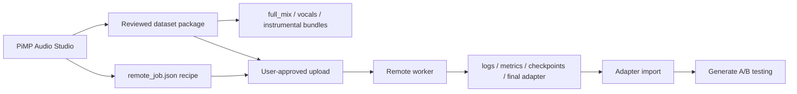

# Cloud Adapter Training Plan

This note captures the recipe fingerprint from the two strong cloud-trained
adapters and turns it into a provider-neutral plan for PiMP Audio Studio.

The important lesson from the inspected jobs is that the good adapters were not
just "cloud GPU" adapters. They were stem-specific, long-running PEFT LoRA jobs
with broad projection coverage and Side-Step's corrected training path.

## Evidence Summary

Two successful cloud jobs were inspected from local training job archives:

| Adapter target | Primary asset | Adapter type | Rank | Alpha | Dropout | Epochs | LR | Grad accum | Target modules | Best loss | Time | Peak VRAM |
|---|---:|---:|---:|---:|---:|---:|---:|---:|---|---:|---:|---:|
| Style quality | instrumental | PEFT LoRA | 96 | 192 | 0.08 | 150 | 0.000075 | 4 | q/k/v/o | 0.4795 | 5h 15m | 10.6 GiB |
| Voice balanced | vocals | PEFT LoRA | 64 | 128 | 0.10 | 100 | 0.000100 | 4 | q/k/v/o | 0.2344 | 4h 03m | 10.3 GiB |

Both jobs used:

- ACE-Step v1.5 XL SFT as the base model.
- 320 clips at about 45 seconds each.
- Separated stems instead of full-mix clips.
- Batch size 1.
- CUDA bf16 mixed precision.
- Cosine scheduler, AdamW, warmup, weight decay, max grad norm, and gradient checkpointing in the worker.
- Corrected Side-Step-style training with CFG dropout ratio 0.15.
- PEFT `adapter_model.safetensors` plus `adapter_config.json` output.
- `use_dora: false`; these two adapters were LoRA, not LoKR or DoRA.

## Why They Sound Better

The likely quality drivers, in descending order:

1. Stem-specific training target. The style adapter trained on instrumental stems, and the voice adapter trained on vocal stems.
2. Much longer schedules. These jobs ran 8,000 to 12,000 optimizer steps, not a quick 5-epoch local smoke test.
3. Broader adapter footprint. They used q/k/v/o projection coverage with rank 64 or 96 and alpha at 2x rank.
4. Corrected remote training behavior. CFG dropout and Side-Step's timestep schedule are part of the training distribution.
5. Dataset annotation. The jobs carried style captions and a character sheet from the upstream dataset pipeline.
6. Runtime maturity. PyTorch plus PEFT plus CUDA handles this wide graph more comfortably than local Swift/MLX currently does.

This does not mean local training is bad. It means local training should stay
Narrow/Wide-with-guards, while the cloud path should intentionally target these
larger stem-specific recipes.

## Simplest Architecture That Works

Keep PiMP Audio Studio as the dataset/package owner. Add a remote adapter job
handoff that writes a richer `remote_job.json`, exports the existing package zip,
and lets an external worker train and return standard artifacts.



## Recommended Architecture

### App Side

PiMP Audio Studio should own:

- Dataset building, review, approval, enrichment, stem bundles, and transcripts.
- Provider-neutral job creation.
- User approval before upload.
- Provider credentials in Keychain only.
- Log/metric polling and display.
- Final adapter import and compatibility checks.

The app should not embed Python, CUDA, Side-Step, ACE-Step Python training, or a
web server runtime.

### Remote Worker Side

The worker should own:

- Reading `remote_training_package.json` and `remote_job.json`.
- Selecting the requested bundle.
- Running preprocessing and training.
- Writing standard logs, metrics, checkpoints, and final adapter artifacts.
- Returning a provider-neutral `remote_artifacts/result.json`.

The first worker can be Side-Step-compatible because that is the known-good
reference behavior. It must stay outside the macOS app boundary.

## Recipe Contract Additions

The existing remote job schema has the right shape, but the training block needs
more detail before it can reproduce these adapters. Add fields like:

```json
{
  "training": {
    "adapter_mode": "lora",
    "adapter_name": "dark-blues-style",
    "recipe": "style_quality",
    "base_model_id": "acestep-v1.5-xl-sft",
    "base_model_label": "ACE-Step v1.5 XL SFT",
    "rank": 96,
    "alpha": 192,
    "dropout": 0.08,
    "epochs": 150,
    "batch_size": 1,
    "gradient_accumulation_steps": 4,
    "learning_rate": 0.000075,
    "target_layers": ["self_attn", "cross_attn"],
    "target_modules": ["q_proj", "k_proj", "v_proj", "o_proj"],
    "training_mode": "corrected",
    "cfg_ratio": 0.15,
    "max_duration_seconds": 240,
    "save_every_epochs": 10,
    "seed": 42,
    "precision": "auto",
    "preprocess_precision": "fp32"
  }
}
```

Recommended initial presets:

| Preset | Bundle | Lyrics hint | Rank | Alpha | Dropout | Epochs | LR |
|---|---|---|---:|---:|---:|---:|---:|
| Style Quality | instrumental | `[Instrumental]` | 96 | 192 | 0.08 | 150 | 0.000075 |
| Voice Balanced | vocals | vocal stem plus transcript lyrics when available | 64 | 128 | 0.10 | 100 | 0.000100 |
| Full Mix Baseline | full_mix | package lyrics or `[Instrumental]` | 64 | 128 | 0.08 | 100 | 0.000100 |

For PiMP packages, Style Quality should prefer
`training_bundle_instrumental.json`, and Voice Balanced should prefer
`training_bundle_vocals.json`.

## Option Comparison

| Option | What it gives us | Tradeoff | Recommendation |
|---|---|---|---|
| Local-only wider recipes | No cloud dependency, simplest UX | Memory and MLX graph risk, slower iteration, less parity with successful jobs | Keep as guarded local path, not the primary cloud-adapter answer |
| Export-only cloud handoff | Fastest to ship, keeps provider work manual | User still launches worker outside the app | Best first cloud-adapter milestone |
| In-app provider launch | Best UX, logs/status/import in one place | More security, billing, provider API, cancellation, and support surface | Build after export-only flow proves recipe parity |
| Fully managed PiMP service | Clean public UX and controlled worker image | Hardest operationally, requires accounts, billing, storage, queueing, support | Later business decision |

## Implementation Path

1. Extend `remote_job.json` training fields so recipes can express alpha,
   dropout, target modules, CFG ratio, precision, save cadence, seed, and max
   duration.
2. Add a Remote GPU job builder UI that lets the user choose target bundle:
   Full Mix, Instrumental Style, or Vocal Voice.
3. Generate a job zip containing the reviewed package plus `remote_job.json`.
4. Build a local dry-run verifier that opens the zip, resolves the bundle, and
   validates the job without training.
5. Create the first external worker against this contract.
6. Add result import for `remote_artifacts/result.json`, PEFT
   `adapter_config.json`, and `adapter_model.safetensors`.
7. Add provider adapters only after the contract and result import are stable.

## Hard-To-Reverse Decisions

- `remote_job.json` field names and artifact layout should be treated as API.
- The final adapter import layout should support PEFT LoRA first, then LoKR and
  DoRA without changing the import root.
- Provider API IDs and secrets must not leak into package zips or job files.
- Cloud recipes should be named by training target and quality level, not by
  provider or implementation detail.

## Security And Privacy

- Keep upload user-approved and visible.
- Redact absolute local paths from uploaded job metadata.
- Store provider credentials in Keychain.
- Never write provider secrets into packages.
- Treat stem audio, captions, lyrics, and transcripts as private user data.

## Cost Signal

The inspected H200 jobs took roughly four to five hours each. Actual cost should
be checked against the selected provider at launch time, because cloud GPU
pricing changes and varies by region/provider. The app should show package size,
GPU class, max runtime, and optional max spend before the first upload.
