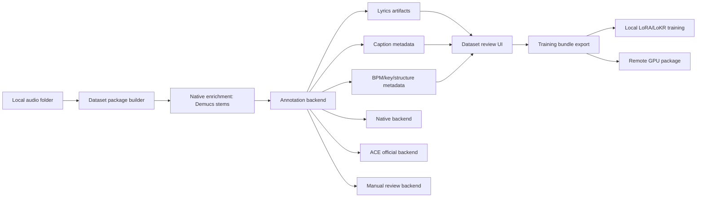

# Dataset Annotation Roadmap

Last refreshed: 2026-06-11.

This document captures external references that may shape PiMP Audio Studio's local dataset builder, annotation pass, and future remote training workflow.

The working principle stays the same: PiMP Audio Studio should keep a native, App Store-friendly path end to end. External training projects are reference material for behavior, formats, and UX only; do not copy code unless its license explicitly allows commercial reuse, and do not add Python, `uv`, CUDA, TensorRT, or browser-server runtime dependencies to the app.

## Status Snapshot

Shipped in PiMP Audio Studio:

- Local dataset building from full-length files, including custom names, larger clip caps, package validation, and reviewed training bundles for full mix, vocals, and instrumental stems.
- Native enrichment with Swift/MLX Demucs, vocal-stem transcription through the native Qwen3-ASR path, BPM/key analysis, raw lyric artifact paths, and annotation provenance fields.
- ACE-compatible sidecar import/export for `.lyrics.txt`, `.lyrics.lrc`, `.caption.txt`, per-track `.json`, and BPM/key/language/time-signature `.csv`, including LRC timestamp cleanup.
- Dataset review workspace with clip audio preview, caption/lyrics/metadata editing, approval gating, readiness warnings, sidecar import/export, and review backups.
- Local LoRA and LoKR training from reviewed packages, including native Swift/MLX preprocessing, LoKR DoRA, corrected timestep/CFG recipe, seeded training, validation loss, optimizer-state checkpoint/resume, metrics/log sidecars, memory guards, and "Test in Generate."
- Generation history and trace sidecars, Generation Analyzer, trace compare, adapter stacks/gain, adapter effect diagnostics, and MCP coverage for generation, editor, trace, and training inspection/control.
- Provider-neutral remote GPU job export: `remote_job.json`, `README_REMOTE_GPU.md`, `run_remote_training.sh`, and the remote worker contract document.

Still future or partial:

- Official ACE-Step captioner/transcriber integration remains reference-only until there is a native Swift/MLX/Core ML path or an approved remote worker.
- Remote GPU provider automation is not yet a full in-app launch/monitor/collect flow; package export is shipped, provider orchestration is future.
- Gradient sensitivity estimation, named dataset/training snapshots, style-tag search, DAW/VST investigation, GGUF/C++ runtime evaluation, and DEMON-style live automation remain future work.
- Live adapter auditioning exists as deterministic generation/trace compare, adapter gain/stacking, and training-completion snapshot runs today; hot switching, prompt A/B blends, checkpoint variant browsing, and timeline automation curves are still future.

## Sources Reviewed

| Reference | What It Is | Relevant Ideas | Integration Fit |
| --- | --- | --- | --- |
| [ace-step/awesome-ace-step](https://github.com/ace-step/awesome-ace-step) | Curated ecosystem index for ACE-Step projects, models, UIs, training tools, integrations, tutorials, and related open-source music models. | Model tiering, GGUF/C++ runtimes, DAW/VST paths, ComfyUI training graphs, hosted/remote runners, Swift/MLX competitors, style-tag browsers, radio modes, and adjacent model landscape. | Strong product radar. Use it to pick references to evaluate; do not treat every listed project as a dependency target. |
| [ACE-Step/acestep-captioner](https://huggingface.co/ACE-Step/acestep-captioner) | ACE-Step 1.5 music caption annotation model based on Qwen2.5-Omni. MIT license, 11B params, roughly 22.4 GB repo. | Official-style music captions covering genre, instruments, arrangement, structure, timbre, and production character. | Useful as an annotation-quality reference; implementation requires a native Swift/MLX/Core ML path or a separately approved native worker. |
| [ACE-Step/acestep-transcriber](https://huggingface.co/ACE-Step/acestep-transcriber) | ACE-Step 1.5 multilingual lyrics and singing transcription model based on Qwen2.5-Omni. MIT license, 11B params, roughly 22.4 GB repo. | Lyrics plus song-section tags like intro, verse, chorus, bridge, instrumental, and language metadata. | Useful as a lyrics-quality reference; implementation requires a native Swift/MLX/Core ML path or a separately approved native worker. |
| [ACE-Step 1.5 LoRA Training Tutorial](https://github.com/PiMPStudios/ACE-Step-1.5/blob/main/docs/en/LoRA_Training_Tutorial.md) | Official ACE-Step LoRA workflow tutorial. | Dataset sidecar conventions, scanner behavior, review requirements, BPM/key CSV import, tensor preprocessing, training parameter guidance, and adapter loading flow. | Strong reference for PiMP Audio Studio's local Training UX and package compatibility. |
| [ACE-Step 1.5 Side-Step Training Guide](https://github.com/PiMPStudios/ACE-Step-1.5/blob/main/docs/sidestep/Training%20Guide.md) | ACE-Step LoRA/LoKR training reference. | Corrected vs Vanilla training modes, adapter-agnostic preprocessing, LoRA/LoKR split, rank/epoch guidance, VRAM options, TensorBoard metrics, checkpoint resume, and gradient sensitivity estimation. | Strong reference for PiMP Audio Studio's Training workspace; reimplement useful behavior natively in Swift/MLX and do not mirror the Python/uv dependency path. |
| [Neyroslav/Ace-Step-1.5-Dataset-Manager](https://github.com/Neyroslav/Ace-Step-1.5-Dataset-Manager) | Qt/C++ desktop editor for ACE Step 1.5 dataset JSON and per-track metadata. | Track cards, audio preview, caption/lyrics editing, metadata fields, backup/reload, focus/lyrics-only review modes. | Strong UI and JSON-compatibility reference; not a runtime dependency or source-code donor. |
| [tsondo/StemForge](https://github.com/tsondo/StemForge) | Local browser-based AI audio workstation using Python/FastAPI/uv with many audio pipelines. | End-to-end pipeline UX: stem separation, MIDI extraction, enhancement, compose/rework, LoRA/LoKR training, snapshots, loss charts, adapter management, mix/export. | Strong workflow reference; not a dependency or source-code donor for the native app. |
| [daydreamlive/DEMON](https://github.com/daydreamlive/DEMON) and [project page](https://daydreamlive.github.io/DEMON/) | Streaming ACE-Step 1.5 engine and live control surface for real-time musical generation. | Ring-buffer streaming, prompt blends, per-frame automation curves, source preservation, x0 target morphing, hot LoRA refit, session snapshots, MCP-driven controls, MIDI learn, and live recording. | Mostly a future creative-runtime reference. Do not inherit its Python/TensorRT/NVIDIA requirements. |

## Simplest Architecture That Works

Keep PiMP Audio Studio's current default local path:

1. Build clips from full-length local audio.
2. Enrich with native Swift/MLX Demucs into `vocals.wav` and `instrumental.wav`.
3. Transcribe vocal stems with the current native Qwen3-ASR path.
4. Estimate BPM locally.
5. Package full-mix, vocal, instrumental, and remote descriptors.
6. Let users review captions and lyrics inside PiMP Audio Studio before training.
7. Preprocess training samples once, then reuse the package cache for later LoRA or LoKR jobs.

Add a provider-neutral annotation layer around this path so the app can later swap in:

- Native local captioner/transcriber.
- Official ACE-Step annotation models.
- A future remote worker for huge models, only if its implementation is explicitly approved and does not become a Python dependency of the app.
- Manual/human-edited metadata.

## Recommended Architecture

Introduce an internal `DatasetAnnotationBackend` concept, even if the first implementation is only current local behavior.



The backend should return structured output rather than appending strings directly to `captions.json`.

Suggested shape:

```json
{
  "annotation_backend": "native-qwen3-asr",
  "annotation_backend_version": "2026-05-29",
  "caption_source": "manual|native|ace-step-captioner|remote",
  "lyrics_source": "manual|native-qwen3-asr|ace-step-transcriber|none",
  "model_id": "Qwen3-ASR-1.7B",
  "model_revision": null,
  "language": "en",
  "caption": "dark blues trio...",
  "lyrics": "[Verse 1] ...",
  "sections": [],
  "bpm": 84.0,
  "key": "E minor",
  "confidence": null,
  "raw_output_file": "annotations/song_001.caption.raw.txt"
}
```

## Option Comparison

| Option | User Experience | Quality Potential | Local/App Store Fit | Engineering Cost | Notes |
| --- | --- | --- | --- | --- | --- |
| Current native enrichment | Best default. No external setup. | Good enough for initial datasets. | Strong. | Shipped and still improving. | Native Demucs, Qwen3-ASR, BPM/key analysis, provenance fields, and raw lyric sidecars are in place. |
| ACE-Step captioner/transcriber local | Advanced opt-in model download. | Likely high, because models match ACE-Step annotation style. | Only acceptable after a native Swift/MLX or Core ML path is proven. | High. | 11B models and Transformers-first packaging make this heavy; do not ship Python/Transformers in the app. |
| ACE-Step captioner/transcriber remote | Potential path for large annotation jobs. | High. | Strong only if optional, privacy-explicit, and not a Python dependency for the app. | Medium/high. | Remote worker contract exists; actual ACE annotation worker/provider adapter remains future work. |
| ACE-compatible sidecar import/export | Familiar to ACE users and easy to inspect. | High if users review data. | Strong. | Shipped. | `.lyrics.txt`, `.lyrics.lrc`, `.caption.txt`, per-track `.json`, and BPM/key/language CSV import/export are first-class package inputs. |
| Dataset Manager-style editor | Great review UX. | Improves human quality. | Strong. | Mostly shipped. | Dataset Review now has audio preview, editable metadata, approval gating, warnings, sidecar import/export, and backups. |
| Side-Step-style LoKR training | Advanced option for smaller/different adapter behavior. | Proven enough for local and cloud experiments, with shape guards still needed. | Strong in native Swift/MLX. | Shipped, with future tuning. | LoKR and DoRA are first-class local training modes; keep LoRA as the safer default and keep broad XL shapes guarded. |
| StemForge-style workstation | Powerful creative workflow. | High for broader audio work. | Mixed. | Large. | Borrow workflow ideas, not the Python app architecture or source code. |
| DEMON-style live runtime | Excellent for interactive cover/remix exploration. | High for auditioning trained adapters and creative edits. | Mixed locally; better as long-term native target. | Very high. | Borrow control concepts: automation curves, hot adapter strength, prompt blending, state snapshots, MCP tools. |
| GGUF/C++ ACE runtime path | Potential App Store-friendly companion runtime if quality and feature support are good enough. | Unknown until tested against MLX path. | Potentially strong. | High. | Track `acestep.cpp`, `acestep.vst3`, and GGUF model coverage as possible future native/compiled runtime options. |
| ComfyUI-style workflow graph | Great for advanced users who want visible pipelines. | Good for reproducibility/debugging. | Strong if native, poor if requiring ComfyUI. | Medium/high. | Borrow graph/run-history ideas, not the dependency stack. |

## Things To Borrow

### From Awesome ACE-Step

- Treat ACE-Step as an ecosystem, not one model file. PiMP Audio Studio's model manager should clearly separate:
  - DiT variant: base, SFT, turbo, turbo-continuous
  - LM planner size: 0.6B, 1.7B, 4B
  - adapter type: LoRA, LoKR, GGUF/quantized where applicable
  - capability flags: generate, cover, repaint, edit, extend, stream, train
- Add capability-aware model selection. The UI should not let users choose a model variant that cannot support the current task without warning.
- Track `acestep.cpp`, `acestep.vst3`, and GGUF quantized models as future zero-Python runtime investigations. This may matter if a C++/Metal/GGML path becomes easier to ship than the current Swift/MLX path for a specific feature.
- Add style-tag search/select inspired by Windows and studio UIs, but keep prompts editable as plain text.
- Add friendlier labels for advanced parameters:
  - "Creativity" for generation freedom
  - "Follow lyrics" for lyric adherence
  - "Preserve source" for repaint/cover strength
  - "Adapter strength" for LoRA/LoKR weight
- Add song parameter history. Status: shipped through history entries, trace sidecars, Generation Analyzer, and trace compare; continue expanding source/reference metadata as cover/edit workflows grow.
- Add a future node/pipeline view for advanced workflows:
  - import
  - stem separation
  - caption/transcribe
  - preprocess
  - train
  - generate/test
  - export
- Add a lightweight "radio/batch audition" mode later. It could continuously generate short fixed-seed samples across prompts, checkpoints, or adapter strengths to help users find promising runs.
- Track the open-source music model landscape as optional future backends, especially where a model is better at a specific job than ACE-Step:
  - lyric-to-full-song generation
  - melody/style conditioning
  - singing voice conversion
  - text-to-audio clips
  - spectrogram or real-time experimentation
- Keep a competitive note on native Swift/MLX apps. If another app has a smoother model manager, adapter browser, or cloud handoff, borrow the product shape without inheriting its code.
- Consider DAW/VST interoperability as a long-term export/integration direction:
  - export stems and full mixes cleanly
  - preserve BPM/key/time signature
  - export session metadata
  - eventually expose PiMP Audio Studio output to a DAW workflow

### From ACE-Step Captioner

- Add a caption enrichment action for full mix and instrumental stems. Status: partial through native metadata captions and manual/sidecar review; official ACE captioner integration remains future.
- Store a detailed training caption separate from short UI labels.
- Capture structured musical metadata:
  - genre and subgenre
  - instruments
  - arrangement/structure
  - timbre and production descriptors
  - mood and energy
- Preserve raw model output sidecars so users can audit and re-run.

### From ACE-Step Transcriber

- Prefer vocal stems as input, not full mixes. Status: shipped for native enrichment/transcription.
- Keep section tags when they are useful: `[Intro]`, `[Verse 1]`, `[Chorus]`, `[Bridge]`, `[Instrumental]`.
- Store language metadata per track. Status: shipped in package metadata and review UI.
- Split full-song transcription into clip-level lyrics only after a full-song pass.
- Mark instrumental clips explicitly instead of fabricating lyrics. Status: shipped in stem bundle handling and training bundle import.

### From ACE-Step LoRA Training Tutorial

- Make ACE-compatible local file conventions first-class. Status: shipped for local package review/import/export:
  - audio files: `.mp3`, `.wav`, `.flac`, `.ogg`, `.opus`
  - lyrics sidecar: `{filename}.lyrics.txt`
  - legacy lyrics sidecar: `{filename}.txt`
  - caption sidecar: `{filename}.caption.txt`
  - metadata sidecar: `{filename}.json`
  - batch BPM/key metadata: `.csv`
- Keep the package scanner transparent. Status: shipped through Dataset Review readiness, validation, and MCP dataset inspection. Each track should show:
  - duration
  - lyrics present/missing
  - caption present/missing
  - BPM/key present/missing
  - language present/missing
  - instrumental/vocal role
  - validation warnings
- Add import/export for ACE-style per-track JSON fields. Status: shipped:
  - `caption`
  - `bpm`
  - `keyscale`
  - `timesignature`
  - `language`
- Treat transcript cleanup as a required review gate, not a nice-to-have.
- Add an LRC cleanup utility that can remove timestamps while preserving lyric lines. Status: shipped for sidecar import.
- Preserve and edit structural tags in lyrics.
- Do not ask an LM to guess BPM/key. Use DSP or explicit CSV/imported metadata.
- Avoid a "genre ratio" style control until it proves useful. Training captions should be more descriptive than generic genre labels.
- Separate the workflow into clear stages:
  - scan/import
  - review/edit
  - save dataset JSON
  - preprocess tensors
  - train adapter
  - load/test adapter
- Evict annotation models before preprocessing/training when they are no longer needed.
- Show VRAM/memory guidance beside training controls, especially batch size and duration.
- Use dataset-size-aware defaults for epochs and checkpoint intervals. Status: shipped for local training recommendations; save interval tuning can keep improving.
- Add a post-training "Load and Test Adapter" action so users can immediately generate a fixed-seed sample. Status: shipped as "Test in Generate."

### From ACE-Step Side-Step Training Guide

- Treat preprocessing as adapter-agnostic. Status: shipped for local LoRA/LoKR package training.
- Default ACE-compatible training to Corrected mode. Status: shipped in the native schedule:
  - continuous logit-normal timestep sampling
  - CFG dropout
  - no requirement for a sibling base ACE-Step checkout
- Keep Vanilla mode as an advanced compatibility/debug option only. Status: future; the shipped local path uses the corrected schedule.
- Keep LoRA as the stable default and present LoKR as experimental until it proves reliable in PiMP Audio Studio. Status: partially superseded; LoKR/DoRA are first-class but still guarded for broad XL shapes.
- Expose a model variant selector that clearly distinguishes base, SFT, and fine-tuned checkpoints. Status: shipped for ACE-Step XL variants and LM sizes.
- Add training presets so users can save/load known-good LoRA and LoKR configurations. Status: partial through Narrow/Wide recipes and dataset-size recommendations; user-saved training presets remain future.
- Add checkpoint resume and visible checkpoint paths. Status: shipped for LoRA and LoKR, including optimizer state.
- Track training metrics in the UI. Status: shipped and still expanding:
  - loss
  - learning rate
  - gradient norm
  - epoch/step progress
  - checkpoint saves
- Preserve full training logs as sidecars for debugging. Status: shipped with `training_log.json` and AUDIODIAG training logs.
- Add a later "estimate target modules" action inspired by gradient sensitivity estimation, so PiMP Audio Studio can recommend attention/MLP target layers instead of making users guess.
- Consider rank/linear-dim ranges beyond the original UI. Status: updated; current UI exposes LoRA rank up to 96 and LoKR linear dim up to 128 with local guards:
  - 16 for quick tests and small datasets
  - 64 as a practical default
  - 128 as an advanced high-capacity option when memory allows
- Consider dataset-size-aware epoch presets. Status: shipped as recommendations:
  - small datasets need much higher epoch counts
  - medium datasets usually need moderate epoch counts
  - larger datasets need fewer epochs
- Keep VRAM controls explicit:
  - batch size
  - gradient accumulation
  - optimizer type
  - encoder/model offload
  - gradient checkpointing status

### From ACE-Step Dataset Manager

- Add a proper dataset review/editor view. Status: mostly shipped:
  - track rows or cards with waveform/audio preview
  - caption and lyrics editors
  - metadata fields for genre, BPM, key, time signature, duration, language
  - changed-field highlighting
  - save, save as, backup, reload
  - expand/collapse long lyrics
  - caption/lyrics-only focus mode
- Make ACE-compatible JSON import/export a visible validation target. Status: shipped through sidecar import/export and tests.

### From StemForge

- Treat dataset building as a pipeline with resumable stages, not a one-shot command.
- Add named snapshots for dataset state and preprocessed tensors.
- Show loss charts and training snapshots in the Training workspace. Status: shipped for loss/LR/validation history and training logs; named snapshots remain future.
- Support both LoRA and LoKR as first-class training modes. Status: shipped.
- Add adapter comparison/A-B generation using a fixed seed. Status: shipped through "Test in Generate," training-completion audition snapshots, adapter gain/stacking, history traces, and trace compare; a dedicated checkpoint browser remains future.
- Add pipeline state recovery after app relaunch.
- Consider a future "Mix/Export" style output review area for stems, MIDI, generated takes, and training candidates.

### From DEMON

DEMON is not primarily a dataset-builder reference. Now that PiMP Audio Studio has dataset review, LoRA/LoKR training, and adapter testing in place, DEMON is more useful as a future model-runtime and editor reference.

- Add a future live audition mode for trained adapters:
  - fixed seed
  - prompt A/B blend
  - LoRA/LoKR strength faders
  - denoise/source-preservation control
  - timbre and structure reference slots
- Treat time-varying controls as timeline automation curves, not just static sliders:
  - denoise
  - source preservation
  - guidance
  - LoRA/LoKR strength
  - prompt blend
  - timbre reference strength
  - structure reference strength
- Save and restore full session state as JSON:
  - prompts
  - seeds
  - model/checkpoint
  - adapters and strengths
  - source/reference clips
  - automation curves
  - render settings
- Add deterministic "adapter audition snapshots" to the Training workspace so users can compare checkpoints with the same prompt, seed, duration, BPM, key, lyrics, and references. Status: shipped for final installed adapters and gain sweeps; checkpoint variant picking remains future.
- Consider hot adapter switching as a runtime goal. Even if native ACE-Step cannot refit weights instantly yet, the UI contract can support enable/disable/strength changes without rebuilding the whole session.
- Add prompt A/B blending as a creative editor feature. This is different from comma-vs-pipe prompt formatting; it is an actual two-conditioning blend.
- Add source/reference role separation:
  - source audio
  - timbre reference
  - structure/rhythm reference
  - lyric/vocal reference
- Make MCP coverage a product goal for creative controls. Every major user-facing generation/edit action should have a matching MCP command eventually.
- Consider MIDI learn later for live performance controls, but keep it outside the dataset-builder MVP.
- Add recording/export of audition sessions so users can preserve the exact output from a live control pass.

## Things Not To Inherit

- Do not require Python for the default local app workflow.
- Do not add Python as an optional app workflow either. Training, annotation, preprocessing, and adapter auditioning should be implemented in Swift/MLX, Core ML, or another App Store-friendly native/compiled path.
- Do not require users to install `uv`, FFmpeg headers, FluidSynth, CUDA, TensorRT, Node.js, or a browser server for basic dataset building.
- Do not copy source code from external projects unless the license explicitly permits commercial reuse and the copied code has been reviewed. Prefer clean-room Swift implementations based on documented behavior, file formats, and observed outputs.
- Do not make official ACE annotation models mandatory. They are too large for the baseline path.
- Do not couple PiMP Audio Studio to sibling apps or external repositories. Use them as references only.
- Do not silently upload audio to remote GPUs. Remote annotation/training must be explicit and reviewable.
- Do not make LoKR the safest/default recommendation just because it exists. Keep LoRA as the conservative default and keep broad local LoKR XL shapes guarded until repeated local runs prove them boring.
- Do not expose every upstream CLI flag directly. Convert the important behavior into native training presets and advanced controls.
- Do not make live streaming generation part of the dataset-builder MVP. It belongs in the Generate/Edit/Training audition surface later.
- Do not assume NVIDIA/TensorRT performance claims transfer to Apple Silicon MLX without separate profiling.
- Do not build a ComfyUI clone. A small native pipeline/status graph is enough unless users prove they need arbitrary node authoring.
- Do not let a style-tag picker replace real prompts and lyrics. It should speed users up, not hide the conditioning text.
- Do not assume GGUF quantization is automatically better than MLX for PiMP Audio Studio. Compare quality, feature coverage, memory, and distribution complexity first.

## Implementation Status

### Shipped: Metadata Contract

- Annotation metadata now lands in `dataset_manifest.json`, `captions.json`, clip entries, and validation summaries.
- Raw lyric output sidecars are stored and referenced from annotation metadata.
- `caption_source`, `lyrics_source`, `annotation_backend`, model/source fields, language, role, BPM, key, time signature, notes, and review status are preserved.
- ACE-compatible sidecars are imported/exported: `.lyrics.txt`, `.lyrics.lrc`, `.caption.txt`, per-track `.json`, and BPM/key/language/time-signature `.csv`.
- `key` and ACE-style `keyscale` are normalized without losing compatibility exports.
- Native enrichment remains the default backend.

### Shipped: Dataset Review UI

- Dataset Review opens reviewed local packages and shows clip rows, readiness warnings, package metrics, and clip-level audio preview.
- Caption, lyrics, BPM, key, language, time signature, role, notes, sources, and annotation backend fields are editable.
- LRC timestamps are stripped from imported lyric sidecars while preserving lyric lines.
- Manual approval gates training readiness.
- Save writes package backups under `review_backups`.
- Sidecar import/export is exposed in the review workflow.
- Still future: dedicated caption-only and lyrics-only focus modes, if the current editor becomes too dense.

### Partial: ACE Annotation Backend

- Shipped: provider-neutral annotation metadata and source names (`manual`, `sidecar`, `native-qwen3-asr`, `ace-step-captioner`, `ace-step-transcriber`, `remote`) are represented in package data.
- Shipped: native enrichment/transcription can populate lyrics, raw lyric outputs, BPM/key, and package status.
- Future: official ACE-Step captioner/transcriber execution, whether local native conversion or remote worker.
- Future: an "Annotate with ACE-Step models" action should stay disabled until a backend exists and privacy/cost UX is ready.

### Partial: Remote GPU Annotation/Training

- Shipped: provider-neutral `remote_job.json` schema and `docs/remote-worker-contract.md`.
- Shipped: Remote GPU export creates a package zip with `remote_job.json`, `README_REMOTE_GPU.md`, and `run_remote_training.sh`.
- Shipped: packages include training bundle descriptors for full mix, vocals, and instrumental roles.
- Future: in-app RunPod/DigitalOcean provider setup, API-token Keychain storage, GPU class/cost controls, launch/monitor/stop, artifact collection, and import.
- Future: remote annotation jobs using the same package/result shape.

### Mostly Shipped: Training Workspace Expansion

- Shipped: LoRA and LoKR tabs train reviewed packages locally through native Swift/MLX.
- Shipped: LoKR supports DoRA-style weight decomposition.
- Shipped: LoRA/LoKR share package/preprocess cache inputs and training bundle descriptors.
- Shipped: corrected ACE-Step-style timestep sampling and CFG dropout are the local default.
- Shipped: Narrow/Wide recipes, dataset-size-aware recommendations, rank/linear-dim controls, layer/projection controls, gradient accumulation, dropout, alpha scaling, and local memory/preflight guards.
- Shipped: checkpoint/pause/resume for LoRA and LoKR, including optimizer state persistence and visible adapter/checkpoint actions.
- Shipped: loss, LR, validation loss, gradient norm, parameter norm, update norm, progress, ETA, checkpoints, and `training_log.json` sidecars.
- Shipped: deterministic "Test in Generate" handoff after training completes.
- Future: user-saved training presets, gradient sensitivity estimation for target module recommendations, named dataset/training snapshots, and an advanced Vanilla compatibility mode if needed.

### Partial: Creative Runtime And Adapter Auditioning

- Shipped: generation trace sidecars, saved trace viewer, trace compare, A/B playback, listening notes, preferred takes, waveform strips, adapter stacks, adapter gain, training-completion audition snapshots, and adapter effect diagnostics.
- Shipped: MCP coverage for generation, lyrics, adapters, history, traces, editor operations, and training inspection/control.
- Shipped: model manager distinguishes ACE-Step DiT variants, shared components, and LM sizes well enough for current Generate/Training workflows.
- Future: dedicated adapter audition workspace across checkpoint variants, style-tag search, prompt A/B blending, source/reference role slots, timeline automation curves, full creative session snapshot import/export, and MIDI learn.

### Future: Ecosystem And Runtime Investigations

- Evaluate `acestep.cpp` and GGUF quantized models against PiMP Audio Studio's MLX path:
  - output quality
  - model coverage
  - cover/repaint/edit support
  - LoRA/LoKR support
  - memory behavior on Apple Silicon
  - App Store packaging implications
- Evaluate `acestep.vst3` and DAW-oriented workflows as references for future export/plugin integration.
- Evaluate ComfyUI ACE workflows for graph/debug ideas:
  - visible node stages
  - cached intermediates
  - live training charts
  - auto-labeling
  - inpainting masks
- Evaluate hosted/remote runners and Docker templates for a standard PiMP Audio Studio remote-worker contract.
- Keep a curated "worth revisiting" list rather than copying the entire awesome list into PiMP Audio Studio docs.

## Hard-To-Reverse Decisions

- Annotation schema names: once packages are created, `caption_source`, `lyrics_source`, `annotation_backend`, and raw sidecar conventions should remain backward-compatible.
- Sidecar compatibility: if PiMP Audio Studio exports ACE-style `.lyrics.txt`, `.caption.txt`, `.json`, and `.csv`, those filename conventions should remain stable.
- Preprocessed tensor cache layout: if LoRA and LoKR share it, version the cache metadata before users build many datasets.
- Training mode names: `corrected` and `vanilla` should be stable once exposed in package manifests and remote job descriptors.
- Model capability schema: if PiMP Audio Studio supports multiple runtime backends, store model identity and capability flags in a stable, versioned shape.
- Automation curve schema: if PiMP Audio Studio stores per-time controls for generation/editing, the curve format should be versioned before users start saving sessions.
- Session snapshot schema: model, adapter, source, reference, seed, and curve fields should be stable enough to reload old creative sessions.
- Remote package layout: RunPod/DigitalOcean workers should consume the same package shape we can re-import locally.
- Privacy boundary: remote upload must be explicit and auditable from day one.
- Dependency boundary: external projects remain reference material unless they are license-compatible, App Store-friendly, and deliberately adopted as native/compiled dependencies.

## Security And Privacy Notes

- Remote annotation/training can include copyrighted or private audio. The app should require explicit confirmation before upload.
- Provider tokens must live in Keychain and never be written into package files.
- Job manifests should redact local absolute paths before upload.
- Raw annotation outputs should be stored locally so users can review model hallucinations before training.
- Voice conversion and model training flows should include consent/rights reminders when user-supplied voices are involved.
- Live recording, microphone input, and session snapshots can capture private audio. They should remain local by default and require clear consent before remote processing.

## Rough Cost Signal

The official ACE annotation models are 11B-class models. Treat them as heavy optional jobs until a native local or approved remote implementation is proven.

Approximate direction:

- Local native enrichment: no infrastructure cost, but uses local GPU memory/time.
- Remote annotation on rented GPU: likely cents to a few dollars per batch depending on audio length, model load time, provider, and whether a warm cache is available.
- Remote LoRA/LoKR training: potentially several dollars to tens of dollars for longer runs on H100/H200-class machines.
- DEMON-style real-time remote generation: potentially higher steady-state cost than batch jobs because the GPU must stay warm while the user is manipulating controls.
- GGUF/C++ runtime investigation: no cloud cost, but significant engineering and QA cost if PiMP Audio Studio supports two inference runtimes.

The important product move is to estimate job size before upload and show a "maximum spend" or "maximum runtime" control.

## Open Questions

- Can the ACE-Step captioner/transcriber be converted to MLX cleanly, or do they depend on Qwen2.5-Omni pieces that are not yet practical in Swift?
- What exact JSON fields does ACE-Step 1.5 training prefer for caption, lyrics, tags, and prompt override?
- Should PiMP Audio Studio store both `key` and `keyscale`, or use one canonical field plus compatibility export?
- What scanner warnings should block training versus merely warn?
- How should PiMP Audio Studio tune save/checkpoint interval recommendations for small, medium, and large datasets now that resume works?
- How aggressively should local memory/preflight guards warn or block LoKR linear dim 128 and full-projection XL shapes?
- Which Corrected-mode settings need to be encoded in PiMP Audio Studio's manifests so local and remote training produce comparable results?
- Should gradient sensitivity estimation be local-only, remote-only, or both?
- Can Apple Silicon MLX support enough of DEMON's live-control idea to make local adapter auditioning feel responsive, even without TensorRT?
- Does `acestep.cpp`/GGUF cover enough ACE-Step 1.5 modes to be useful for PiMP Audio Studio, or is it generation-only for now?
- Should PiMP Audio Studio's model manager support multiple runtime backends per model, or should the app pick exactly one local runtime?
- Which style-tag taxonomy is actually useful for users: ACE ecosystem tags, Suno-style tags, or PiMP Audio Studio's own curated set?
- What should the first DAW interoperability milestone be: export-only, VST/AU plugin, local server bridge, or drag-and-drop stems with metadata?
- What is the smallest useful automation curve model for PiMP Audio Studio: points plus interpolation, rendered per beat, rendered per second, or rendered per latent frame?
- Should session snapshots live beside History items, Training runs, or a dedicated project/session library?
- Should full-mix captions be generated before or after stem separation?
- Should instrumental stems get separate captions from full mixes?
- Do we want key detection from DSP first, or from captioner output plus DSP verification?
- What should the first integrated RunPod/DigitalOcean provider flow be now that local package export and `run_remote_training.sh` exist?

## Current Recommendation

The low-risk PiMP Audio Studio-native foundation is mostly in place. The next useful work should focus on the gaps that make the shipped pieces more repeatable:

1. Polish Remote GPU into an integrated provider flow: RunPod/DigitalOcean credentials, cost/time guardrails, launch/monitor/stop, artifact pullback, and adapter import.
2. Keep ACE official captioner/transcriber as optional backend targets, but do not start until the worker contract and privacy/cost UX are solid.
3. Add user-saved training presets and named dataset/training snapshots so good local and cloud recipes can be reused without reconstructing settings by hand.
4. Expand adapter audition snapshots into a dedicated workspace with checkpoint variant browsing, strength sweeps, fixed-seed prompts, and richer take grouping.
5. Revisit gradient sensitivity estimation only after more local/cloud training logs exist; it should recommend target modules from evidence, not guesswork.
6. Treat DEMON as a Generate/Edit/Training audition reference for automation curves, live adapter controls, session snapshots, and MCP command coverage.
7. Keep Awesome ACE-Step as the ongoing radar for zero-Python runtimes, style-tag UX, DAW/export ideas, workflow graphs, and remote worker references.
