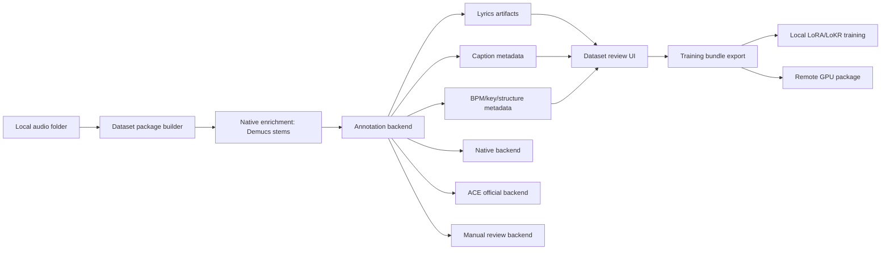

# Dataset Annotation Roadmap

This document captures external references that may shape Anvil's local dataset builder, annotation pass, and future remote training workflow.

The working principle stays the same: Anvil should keep a native, App Store-friendly local path by default, while allowing larger Python/Transformers/CUDA workflows to live behind explicit optional or remote backends.

## Sources Reviewed

| Reference | What It Is | Relevant Ideas | Integration Fit |
| --- | --- | --- | --- |
| [ace-step/awesome-ace-step](https://github.com/ace-step/awesome-ace-step) | Curated ecosystem index for ACE-Step projects, models, UIs, training tools, integrations, tutorials, and related open-source music models. | Model tiering, GGUF/C++ runtimes, DAW/VST paths, ComfyUI training graphs, hosted/remote runners, Swift/MLX competitors, style-tag browsers, radio modes, and adjacent model landscape. | Strong product radar. Use it to pick references to evaluate; do not treat every listed project as a dependency target. |
| [ACE-Step/acestep-captioner](https://huggingface.co/ACE-Step/acestep-captioner) | ACE-Step 1.5 music caption annotation model based on Qwen2.5-Omni. MIT license, 11B params, roughly 22.4 GB repo. | Official-style music captions covering genre, instruments, arrangement, structure, timbre, and production character. | Best as an optional annotation backend first, likely remote GPU before local. |
| [ACE-Step/acestep-transcriber](https://huggingface.co/ACE-Step/acestep-transcriber) | ACE-Step 1.5 multilingual lyrics and singing transcription model based on Qwen2.5-Omni. MIT license, 11B params, roughly 22.4 GB repo. | Lyrics plus song-section tags like intro, verse, chorus, bridge, instrumental, and language metadata. | Best as an optional lyrics backend first, likely remote GPU before local. |
| [ACE-Step 1.5 LoRA Training Tutorial](https://github.com/PiMPStudios/ACE-Step-1.5/blob/main/docs/en/LoRA_Training_Tutorial.md) | Official ACE-Step LoRA workflow tutorial. | Dataset sidecar conventions, scanner behavior, review requirements, BPM/key CSV import, tensor preprocessing, training parameter guidance, and adapter loading flow. | Strong reference for Anvil's local Training UX and package compatibility. |
| [ACE-Step 1.5 Side-Step Training Guide](https://github.com/PiMPStudios/ACE-Step-1.5/blob/main/docs/sidestep/Training%20Guide.md) | ACE-Step LoRA/LoKR training reference. | Corrected vs Vanilla training modes, adapter-agnostic preprocessing, LoRA/LoKR split, rank/epoch guidance, VRAM options, TensorBoard metrics, checkpoint resume, and gradient sensitivity estimation. | Strong reference for Anvil's Training workspace; do not mirror the Python/uv dependency path. |
| [Neyroslav/Ace-Step-1.5-Dataset-Manager](https://github.com/Neyroslav/Ace-Step-1.5-Dataset-Manager) | Qt/C++ desktop editor for ACE Step 1.5 dataset JSON and per-track metadata. | Track cards, audio preview, caption/lyrics editing, metadata fields, backup/reload, focus/lyrics-only review modes. | Strong UI and JSON-compatibility reference; not a runtime dependency. |
| [tsondo/StemForge](https://github.com/tsondo/StemForge) | Local browser-based AI audio workstation using Python/FastAPI/uv with many audio pipelines. | End-to-end pipeline UX: stem separation, MIDI extraction, enhancement, compose/rework, LoRA/LoKR training, snapshots, loss charts, adapter management, mix/export. | Strong workflow reference; not a dependency for the native app. |
| [daydreamlive/DEMON](https://github.com/daydreamlive/DEMON) and [project page](https://daydreamlive.github.io/DEMON/) | Streaming ACE-Step 1.5 engine and live control surface for real-time musical generation. | Ring-buffer streaming, prompt blends, per-frame automation curves, source preservation, x0 target morphing, hot LoRA refit, session snapshots, MCP-driven controls, MIDI learn, and live recording. | Mostly a future creative-runtime reference. Do not inherit its Python/TensorRT/NVIDIA requirements for Anvil's default local path. |

## Simplest Architecture That Works

Keep Anvil's current default local path:

1. Build clips from full-length local audio.
2. Enrich with native Swift/MLX Demucs into `vocals.wav` and `instrumental.wav`.
3. Transcribe vocal stems with the current native Qwen3-ASR path.
4. Estimate BPM locally.
5. Package full-mix, vocal, instrumental, and remote descriptors.
6. Let users review captions and lyrics inside Anvil before training.
7. Preprocess training samples once, then reuse the package cache for later LoRA or LoKR jobs.

Add a provider-neutral annotation layer around this path so the app can later swap in:

- Native local captioner/transcriber.
- Official ACE-Step annotation models.
- A remote GPU worker for huge models.
- Manual/human-edited metadata.

## Recommended Architecture

Introduce an internal `DatasetAnnotationBackend` concept, even if the first implementation is only current local behavior.



The backend should return structured output rather than appending strings directly to `captions.json`.

Suggested shape:

```json
{
  "annotation_backend": "native-qwen3-asr",
  "annotation_backend_version": "2026-05-29",
  "caption_source": "manual|native|ace-step-captioner|remote",
  "lyrics_source": "manual|native-qwen3-asr|ace-step-transcriber|none",
  "model_id": "Qwen3-ASR-1.7B",
  "model_revision": null,
  "language": "en",
  "caption": "dark blues trio...",
  "lyrics": "[Verse 1] ...",
  "sections": [],
  "bpm": 84.0,
  "key": "E minor",
  "confidence": null,
  "raw_output_file": "annotations/song_001.caption.raw.txt"
}
```

## Option Comparison

| Option | User Experience | Quality Potential | Local/App Store Fit | Engineering Cost | Notes |
| --- | --- | --- | --- | --- | --- |
| Current native enrichment | Best default. No external setup. | Good enough for initial datasets. | Strong. | Already mostly built. | Keep improving this first. |
| ACE-Step captioner/transcriber local | Advanced opt-in model download. | Likely high, because models match ACE-Step annotation style. | Unclear until MLX/Core ML conversion is proven. | High. | 11B models and Transformers-first packaging make this heavy. |
| ACE-Step captioner/transcriber remote | Cleanest path for large annotation jobs. | High. | Strong if optional and privacy-explicit. | Medium/high. | Fits RunPod/DigitalOcean workflow. Needs job packaging and credentials. |
| ACE-compatible sidecar import/export | Familiar to ACE users and easy to inspect. | High if users review data. | Strong. | Low/medium. | Support `.lyrics.txt`, `.caption.txt`, per-track `.json`, and BPM/key CSV as first-class package inputs. |
| Dataset Manager-style editor | Great review UX. | Improves human quality. | Strong. | Medium. | Pure Anvil UI work; no model risk. |
| Side-Step-style LoKR training | Advanced option for smaller/different adapter behavior. | Unknown until tested in Anvil's pipeline. | Strong if implemented in native/local or optional remote worker. | Medium/high. | Keep LoRA as the stable default and label LoKR experimental. |
| StemForge-style workstation | Powerful creative workflow. | High for broader audio work. | Mixed. | Large. | Borrow workflow ideas, not the Python app architecture. |
| DEMON-style live runtime | Excellent for interactive cover/remix exploration. | High for auditioning trained adapters and creative edits. | Mixed locally; better as long-term native/remote target. | Very high. | Borrow control concepts: automation curves, hot adapter strength, prompt blending, state snapshots, MCP tools. |
| GGUF/C++ ACE runtime path | Better App Store story than Python if quality and feature support are good enough. | Unknown until tested against MLX path. | Potentially strong. | High. | Track `acestep.cpp`, `acestep.vst3`, and GGUF model coverage as a possible future runtime option. |
| ComfyUI-style workflow graph | Great for advanced users who want visible pipelines. | Good for reproducibility/debugging. | Strong if native, poor if requiring ComfyUI. | Medium/high. | Borrow graph/run-history ideas, not the dependency stack. |

## Things To Borrow

### From Awesome ACE-Step

- Treat ACE-Step as an ecosystem, not one model file. Anvil's model manager should clearly separate:
  - DiT variant: base, SFT, turbo, turbo-continuous
  - LM planner size: 0.6B, 1.7B, 4B
  - adapter type: LoRA, LoKR, GGUF/quantized where applicable
  - capability flags: generate, cover, repaint, edit, extend, stream, train
- Add capability-aware model selection. The UI should not let users choose a model variant that cannot support the current task without warning.
- Track `acestep.cpp`, `acestep.vst3`, and GGUF quantized models as a future zero-Python runtime investigation. This may matter if a C++/Metal/GGML path becomes easier to ship than a full Python or Transformers stack.
- Add style-tag search/select inspired by Windows and studio UIs, but keep prompts editable as plain text.
- Add friendlier labels for advanced parameters:
  - "Creativity" for generation freedom
  - "Follow lyrics" for lyric adherence
  - "Preserve source" for repaint/cover strength
  - "Adapter strength" for LoRA/LoKR weight
- Add song parameter history. Users should be able to reopen a generated item and see the exact prompt, lyrics, model variant, seed, duration, guidance, adapter list, and source files.
- Add a future node/pipeline view for advanced workflows:
  - import
  - stem separation
  - caption/transcribe
  - preprocess
  - train
  - generate/test
  - export
- Add a lightweight "radio/batch audition" mode later. It could continuously generate short fixed-seed samples across prompts, checkpoints, or adapter strengths to help users find promising runs.
- Track the open-source music model landscape as optional future backends, especially where a model is better at a specific job than ACE-Step:
  - lyric-to-full-song generation
  - melody/style conditioning
  - singing voice conversion
  - text-to-audio clips
  - spectrogram or real-time experimentation
- Keep a competitive note on native Swift/MLX apps. If another app has a smoother model manager, adapter browser, or cloud handoff, borrow the product shape without inheriting its code.
- Consider DAW/VST interoperability as a long-term export/integration direction:
  - export stems and full mixes cleanly
  - preserve BPM/key/time signature
  - export session metadata
  - eventually expose Anvil output to a DAW workflow

### From ACE-Step Captioner

- Add a caption enrichment action for full mix and instrumental stems.
- Store a detailed training caption separate from short UI labels.
- Capture structured musical metadata:
  - genre and subgenre
  - instruments
  - arrangement/structure
  - timbre and production descriptors
  - mood and energy
- Preserve raw model output sidecars so users can audit and re-run.

### From ACE-Step Transcriber

- Prefer vocal stems as input, not full mixes.
- Keep section tags when they are useful: `[Intro]`, `[Verse 1]`, `[Chorus]`, `[Bridge]`, `[Instrumental]`.
- Store language metadata per track.
- Split full-song transcription into clip-level lyrics only after a full-song pass.
- Mark instrumental clips explicitly instead of fabricating lyrics.

### From ACE-Step LoRA Training Tutorial

- Make ACE-compatible local file conventions first-class:
  - audio files: `.mp3`, `.wav`, `.flac`, `.ogg`, `.opus`
  - lyrics sidecar: `{filename}.lyrics.txt`
  - legacy lyrics sidecar: `{filename}.txt`
  - caption sidecar: `{filename}.caption.txt`
  - metadata sidecar: `{filename}.json`
  - batch BPM/key metadata: `.csv`
- Keep the package scanner transparent. Each track should show:
  - duration
  - lyrics present/missing
  - caption present/missing
  - BPM/key present/missing
  - language present/missing
  - instrumental/vocal role
  - validation warnings
- Add import/export for ACE-style per-track JSON fields:
  - `caption`
  - `bpm`
  - `keyscale`
  - `timesignature`
  - `language`
- Treat transcript cleanup as a required review gate, not a nice-to-have.
- Add an LRC cleanup utility that can remove timestamps while preserving lyric lines.
- Preserve and edit structural tags in lyrics.
- Do not ask an LM to guess BPM/key. Use DSP or explicit CSV/imported metadata.
- Avoid a "genre ratio" style control until it proves useful. Training captions should be more descriptive than generic genre labels.
- Separate the workflow into clear stages:
  - scan/import
  - review/edit
  - save dataset JSON
  - preprocess tensors
  - train adapter
  - load/test adapter
- Evict annotation models before preprocessing/training when they are no longer needed.
- Show VRAM/memory guidance beside training controls, especially batch size and duration.
- Use dataset-size-aware defaults for epochs and checkpoint intervals.
- Add a post-training "Load and Test Adapter" action so users can immediately generate a fixed-seed sample.

### From ACE-Step Side-Step Training Guide

- Treat preprocessing as adapter-agnostic. One preprocessed tensor cache should be reusable for both LoRA and LoKR training.
- Default future ACE-compatible training to Corrected mode:
  - continuous logit-normal timestep sampling
  - CFG dropout
  - no requirement for a sibling base ACE-Step checkout
- Keep Vanilla mode as an advanced compatibility/debug option only.
- Keep LoRA as the stable default and present LoKR as experimental until it proves reliable in Anvil.
- Expose a model variant selector that clearly distinguishes base, SFT, and fine-tuned checkpoints.
- Add training presets so users can save/load known-good LoRA and LoKR configurations.
- Add checkpoint resume and visible checkpoint paths.
- Track training metrics in the UI:
  - loss
  - learning rate
  - gradient norm
  - epoch/step progress
  - checkpoint saves
- Preserve full training logs as sidecars for debugging.
- Add a later "estimate target modules" action inspired by gradient sensitivity estimation, so Anvil can recommend attention/MLP target layers instead of making users guess.
- Consider rank/linear-dim ranges beyond the current UI:
  - 16 for quick tests and small datasets
  - 64 as a practical default
  - 128 as an advanced high-capacity option when memory allows
- Consider dataset-size-aware epoch presets:
  - small datasets need much higher epoch counts
  - medium datasets usually need moderate epoch counts
  - larger datasets need fewer epochs
- Keep VRAM controls explicit:
  - batch size
  - gradient accumulation
  - optimizer type
  - encoder/model offload
  - gradient checkpointing status

### From ACE-Step Dataset Manager

- Add a proper dataset review/editor view:
  - track rows or cards with waveform/audio preview
  - caption and lyrics editors
  - metadata fields for genre, BPM, key, time signature, duration, language
  - changed-field highlighting
  - save, save as, backup, reload
  - expand/collapse long lyrics
  - caption/lyrics-only focus mode
- Make ACE-compatible JSON import/export a visible validation target.

### From StemForge

- Treat dataset building as a pipeline with resumable stages, not a one-shot command.
- Add named snapshots for dataset state and preprocessed tensors.
- Show loss charts and training snapshots in the Training workspace.
- Support both LoRA and LoKR as first-class training modes.
- Add adapter comparison/A-B generation using a fixed seed.
- Add pipeline state recovery after app relaunch.
- Consider a future "Mix/Export" style output review area for stems, MIDI, generated takes, and training candidates.

### From DEMON

DEMON is not primarily a dataset-builder reference. It is more useful as a future model-runtime and editor reference after Anvil has dataset review, LoRA/LoKR training, and adapter testing in place.

- Add a future live audition mode for trained adapters:
  - fixed seed
  - prompt A/B blend
  - LoRA/LoKR strength faders
  - denoise/source-preservation control
  - timbre and structure reference slots
- Treat time-varying controls as timeline automation curves, not just static sliders:
  - denoise
  - source preservation
  - guidance
  - LoRA/LoKR strength
  - prompt blend
  - timbre reference strength
  - structure reference strength
- Save and restore full session state as JSON:
  - prompts
  - seeds
  - model/checkpoint
  - adapters and strengths
  - source/reference clips
  - automation curves
  - render settings
- Add deterministic "adapter audition snapshots" to the Training workspace so users can compare checkpoints with the same prompt, seed, duration, BPM, key, lyrics, and references.
- Consider hot adapter switching as a runtime goal. Even if native ACE-Step cannot refit weights instantly yet, the UI contract can support enable/disable/strength changes without rebuilding the whole session.
- Add prompt A/B blending as a creative editor feature. This is different from comma-vs-pipe prompt formatting; it is an actual two-conditioning blend.
- Add source/reference role separation:
  - source audio
  - timbre reference
  - structure/rhythm reference
  - lyric/vocal reference
- Make MCP coverage a product goal for creative controls. Every major user-facing generation/edit action should have a matching MCP command eventually.
- Consider MIDI learn later for live performance controls, but keep it outside the dataset-builder MVP.
- Add recording/export of audition sessions so users can preserve the exact output from a live control pass.

## Things Not To Inherit

- Do not require Python for the default local app workflow.
- Do not require users to install `uv`, FFmpeg headers, FluidSynth, CUDA, TensorRT, Node.js, or a browser server for basic dataset building.
- Do not make official ACE annotation models mandatory. They are too large for the baseline path.
- Do not couple AnvilApp to sibling apps or external repositories. Use them as references only.
- Do not silently upload audio to remote GPUs. Remote annotation/training must be explicit and reviewable.
- Do not make LoKR the default training path until it has the same reliability as LoRA in Anvil's own tests.
- Do not expose every Python CLI flag directly. Convert the important ones into native training presets and advanced controls.
- Do not make live streaming generation part of the dataset-builder MVP. It belongs in the Generate/Edit/Training audition surface later.
- Do not assume NVIDIA/TensorRT performance claims transfer to Apple Silicon MLX without separate profiling.
- Do not build a ComfyUI clone. A small native pipeline/status graph is enough unless users prove they need arbitrary node authoring.
- Do not let a style-tag picker replace real prompts and lyrics. It should speed users up, not hide the conditioning text.
- Do not assume GGUF quantization is automatically better than MLX for Anvil. Compare quality, feature coverage, memory, and distribution complexity first.

## Implementation Backlog

### Phase 1: Metadata Contract

- Add an annotation result schema to `dataset_manifest.json` and clip entries.
- Add raw-output sidecar paths for captions and lyrics.
- Add `caption_source`, `lyrics_source`, `annotation_backend`, `model_id`, and `model_revision`.
- Add ACE-compatible sidecar mappings for `.lyrics.txt`, `.caption.txt`, per-track `.json`, and BPM/key `.csv`.
- Normalize `key` and ACE-style `keyscale` without losing the original imported value.
- Keep current native enrichment behavior as the first backend implementation.

### Phase 2: Dataset Review UI

- Add a Datasets detail/editor view for package clips.
- Add audio preview per clip.
- Add caption, lyrics, BPM, key, language, role, and notes fields.
- Add scanner status columns for missing lyrics, captions, BPM/key, language, duration, and validation warnings.
- Add LRC timestamp cleanup for imported lyric files.
- Add a manual review/approved flag before a package is marked training-ready.
- Add changed-field highlighting and package backup before save.
- Add focus modes for captions-only and lyrics-only review.

### Phase 3: ACE Annotation Backend

- Add backend enum entries for:
  - `native`
  - `ace-step-captioner`
  - `ace-step-transcriber`
  - `remote-gpu`
  - `manual`
- Build request/response structs independent of any one model.
- Add an "Annotate with ACE-Step models" action that is disabled until a backend exists.
- Start with remote GPU first unless MLX/Core ML conversion proves easy.

### Phase 4: Remote GPU Annotation/Training

- Define a provider-neutral remote worker contract before provider API integration.
- Extend `remote_training_package.json` to advertise annotation jobs as well as training jobs.
- Add provider settings for RunPod/DigitalOcean:
  - API token storage in Keychain
  - target GPU class
  - model cache volume
  - max job cost/timeout
- Package audio with a manifest that can run caption/transcription/stem/train stages.
- Pull back artifacts into the same local package layout.

### Phase 5: Training Workspace Expansion

- Fill the current Training tabs:
  - LoRA: current local flow
  - LoKR: experimental compact adapter training
  - Remote GPU: package, launch, monitor, collect checkpoint
- Reuse one preprocessed dataset cache for LoRA and LoKR.
- Add a Corrected/Vanilla mode selector, with Corrected as the default.
- Add optimizer choices and VRAM controls to Advanced.
- Add training presets for common dataset sizes and adapter goals.
- Add epoch and save-interval recommendations based on track count and total duration.
- Add checkpoint resume.
- Add training charts for loss, LR, and gradient norms.
- Add a gradient sensitivity estimator for target-layer recommendations.
- Add named snapshots.
- Add deterministic A/B test generation after training.
- Add adapter comparison view with fixed seed, prompt, lyrics, and trace sidecars.
- Add a "Load and Test Adapter" flow after training completes.

### Phase 6: Creative Runtime And Adapter Auditioning

- Add model capability metadata for DiT variant, LM size, supported modes, training support, and runtime backend.
- Add an adapter audition workspace that can render fixed-seed comparisons across checkpoints and strengths.
- Add song parameter history and exact-generation trace restore.
- Add style-tag search/select, while keeping full prompt editing visible.
- Add prompt A/B blending and source/reference role slots.
- Add timeline automation curves for denoise, guidance, source preservation, prompt blend, and adapter strength.
- Add full session snapshot import/export.
- Add MCP commands for generation, editing, adapter selection, automation changes, and snapshot restore.
- Add optional MIDI learn only after the core automation model is stable.
- Keep this phase independent from the dataset-builder MVP.

### Phase 7: Ecosystem And Runtime Investigations

- Evaluate `acestep.cpp` and GGUF quantized models against Anvil's MLX path:
  - output quality
  - model coverage
  - cover/repaint/edit support
  - LoRA/LoKR support
  - memory behavior on Apple Silicon
  - App Store packaging implications
- Evaluate `acestep.vst3` and DAW-oriented workflows as references for future export/plugin integration.
- Evaluate ComfyUI ACE workflows for graph/debug ideas:
  - visible node stages
  - cached intermediates
  - live training charts
  - auto-labeling
  - inpainting masks
- Evaluate hosted/remote runners and Docker templates for a standard Anvil remote-worker contract.
- Keep a curated "worth revisiting" list rather than copying the entire awesome list into Anvil docs.

## Hard-To-Reverse Decisions

- Annotation schema names: once packages are created, `caption_source`, `lyrics_source`, `annotation_backend`, and raw sidecar conventions should remain backward-compatible.
- Sidecar compatibility: if Anvil exports ACE-style `.lyrics.txt`, `.caption.txt`, `.json`, and `.csv`, those filename conventions should remain stable.
- Preprocessed tensor cache layout: if LoRA and LoKR share it, version the cache metadata before users build many datasets.
- Training mode names: `corrected` and `vanilla` should be stable once exposed in package manifests and remote job descriptors.
- Model capability schema: if Anvil supports multiple runtime backends, store model identity and capability flags in a stable, versioned shape.
- Automation curve schema: if Anvil stores per-time controls for generation/editing, the curve format should be versioned before users start saving sessions.
- Session snapshot schema: model, adapter, source, reference, seed, and curve fields should be stable enough to reload old creative sessions.
- Remote package layout: RunPod/DigitalOcean workers should consume the same package shape we can re-import locally.
- Privacy boundary: remote upload must be explicit and auditable from day one.
- Dependency boundary: Python/Transformers backends should remain optional workers, not required app components.

## Security And Privacy Notes

- Remote annotation/training can include copyrighted or private audio. The app should require explicit confirmation before upload.
- Provider tokens must live in Keychain and never be written into package files.
- Job manifests should redact local absolute paths before upload.
- Raw annotation outputs should be stored locally so users can review model hallucinations before training.
- Voice conversion and model training flows should include consent/rights reminders when user-supplied voices are involved.
- Live recording, microphone input, and session snapshots can capture private audio. They should remain local by default and require clear consent before remote processing.

## Rough Cost Signal

The official ACE annotation models are 11B-class models. Treat them as remote GPU jobs until proven otherwise.

Approximate direction:

- Local native enrichment: no infrastructure cost, but uses local GPU memory/time.
- Remote annotation on rented GPU: likely cents to a few dollars per batch depending on audio length, model load time, provider, and whether a warm cache is available.
- Remote LoRA/LoKR training: potentially several dollars to tens of dollars for longer runs on H100/H200-class machines.
- DEMON-style real-time remote generation: potentially higher steady-state cost than batch jobs because the GPU must stay warm while the user is manipulating controls.
- GGUF/C++ runtime investigation: no cloud cost, but significant engineering and QA cost if Anvil supports two inference runtimes.

The important product move is to estimate job size before upload and show a "maximum spend" or "maximum runtime" control.

## Open Questions

- Can the ACE-Step captioner/transcriber be converted to MLX cleanly, or do they depend on Qwen2.5-Omni pieces that are not yet practical in Swift?
- What exact JSON fields does ACE-Step 1.5 training prefer for caption, lyrics, tags, and prompt override?
- Should Anvil store both `key` and `keyscale`, or use one canonical field plus compatibility export?
- What scanner warnings should block training versus merely warn?
- How should Anvil choose save/checkpoint intervals for small, medium, and large datasets?
- Should Anvil expose LoKR rank/linear-dim up to 128 immediately, or keep 128 behind an advanced warning until local memory behavior is known?
- Which Corrected-mode settings need to be encoded in Anvil's manifests so local and remote training produce comparable results?
- Should gradient sensitivity estimation be local-only, remote-only, or both?
- Can Apple Silicon MLX support enough of DEMON's live-control idea to make local adapter auditioning feel responsive, even without TensorRT?
- Does `acestep.cpp`/GGUF cover enough ACE-Step 1.5 modes to be useful for Anvil, or is it generation-only for now?
- Should Anvil's model manager support multiple runtime backends per model, or should the app pick exactly one local runtime?
- Which style-tag taxonomy is actually useful for users: ACE ecosystem tags, Suno-style tags, or Anvil's own curated set?
- What should the first DAW interoperability milestone be: export-only, VST/AU plugin, local server bridge, or drag-and-drop stems with metadata?
- What is the smallest useful automation curve model for Anvil: points plus interpolation, rendered per beat, rendered per second, or rendered per latent frame?
- Should session snapshots live beside History items, Training runs, or a dedicated project/session library?
- Should full-mix captions be generated before or after stem separation?
- Should instrumental stems get separate captions from full mixes?
- Do we want key detection from DSP first, or from captioner output plus DSP verification?
- What should be the minimum viable RunPod/DigitalOcean worker contract?

## Near-Term Recommendation

Do the low-risk Anvil-native work first:

1. Add the annotation metadata fields and raw-output sidecar conventions. Status: package schema, clip provenance, manifest summaries, and raw lyric artifact paths are now in place.
2. Build the dataset review/editor UI. Status: the current review workspace edits metadata, imports sidecars, gates training on approval, and writes review backups before save.
3. Add ACE-compatible sidecar import/export for `.lyrics.txt`, `.caption.txt`, per-track `.json`, and BPM/key `.csv`. Status: import and export are wired; key/keyscale metadata is reflected as metadata-backed analysis status, while standalone DSP key detection remains pending.
4. Keep current native Demucs plus Qwen3-ASR as default. Status: default local enrichment remains native Swift/MLX and tags Qwen lyric output as `native-qwen3-asr`.
5. Add ACE official captioner/transcriber as a remote backend target. Status: provider-neutral `remote_job.json` / `result.json` schema is now defined; actual ACE annotation worker and provider adapters remain future work.
6. Add LoKR as an experimental Training tab that reuses the same preprocessed tensors as LoRA. Status: the LoKR tab now lists reviewed packages and cache readiness, and bundle-based preprocessing now writes sample-level safetensors plus `index.json`; the native LoKR optimizer/training loop remains future work.
7. Use StemForge as a workflow/UX reference for LoKR, snapshots, A/B adapter comparison, and remote training monitoring.
8. Treat DEMON as a later Generate/Edit/Training audition reference for automation curves, live adapter controls, session snapshots, and MCP command coverage.
9. Use Awesome ACE-Step as the ongoing radar for zero-Python runtimes, style-tag UX, DAW/export ideas, workflow graphs, and remote worker references.
