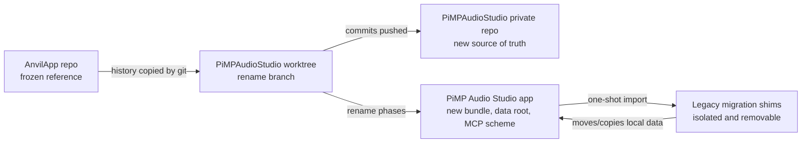

# Full Rebrand Plan: AnvilApp to PiMP Audio Studio

## Decision

We are moving the unreleased AnvilApp codebase into a new private repository,
`PiMPStudios/PiMPAudioStudio`, and treating that repository as the forward
source of truth for a full product rebrand.

The old `PiMPStudios/AnvilApp` repository remains a clean pre-rename reference
until the renamed app is building, tested, and carrying over the local data we
care about. We should avoid new feature work in the old checkout unless there is
an emergency fix that must be cherry-picked forward.

## Recommended Stance

The clean break is worth doing now. The app is unreleased, the current "Anvil"
name overlaps with existing audio/music software, and the longer we wait the
more screenshots, docs, App Store metadata, support notes, dataset packages, MCP
clients, and user expectations will accumulate around the wrong identity.

The only intentional exception is migration compatibility. We may need legacy
constants and one-shot migration code that knows about `Anvil`, `AnvilApp`, and
`anvil://`, but those references should be isolated, named as legacy support,
and removable later.

## Proposed Target Names

These are the working defaults unless we explicitly change them before the first
code rename pass:

| Surface | Current | Proposed |
| --- | --- | --- |
| Product display name | `Anvil` | `PiMP Audio Studio` |
| GitHub repo | `PiMPStudios/AnvilApp` | `PiMPStudios/PiMPAudioStudio` |
| App target / folder | `AnvilApp` | `PiMPAudioStudio` |
| Test target / folder | `AnvilAppTests` | `PiMPAudioStudioTests` |
| Core package / module | `AnvilCore` | `PiMPAudioCore` |
| Xcode project | `AnvilApp.xcodeproj` | `PiMPAudioStudio.xcodeproj` |
| App entry point | `AnvilAppApp` | `PiMPAudioStudioApp` |
| Bundle ID | `net.pimp.anvil.AnvilApp` | `com.pimpstudios.PiMPAudioStudio` |
| Logger subsystem | `com.pimp.AnvilApp` | `com.pimpstudios.PiMPAudioStudio` |
| Keychain service | `com.pimpstudios.anvil.apikeys` | `com.pimpstudios.pimpaudiostudio.apikeys` |
| App Support root | `Application Support/Anvil` | `Application Support/PiMP Audio Studio` |
| MCP URI scheme | `anvil://` | `pimpaudio://` |
| MCP facade | `AnvilCommandFacade` | `PiMPAudioCommandFacade` |
| MCP server | `AnvilMCPServer` | `PiMPAudioMCPServer` |
| Tokenizer wrapper | `AnvilTokenizer` | `PiMPAudioTokenizer` |

Open naming checks before execution:

- Confirm whether the bundle ID should use `com.pimpstudios.PiMPAudioStudio`,
  `net.pimp.PiMPAudioStudio`, or another reverse-DNS identity tied to the final
  developer account.
- Confirm whether the MCP scheme should be `pimpaudio://` or something else.
  `pimpaudio://` is the current recommendation because it is short, stable, and
  less awkward than `pimp://`.
- Confirm whether deep format keys such as `anvil_schema_version` should become
  `pimp_audio_schema_version` immediately, or be version-bumped only when those
  payloads materially change.

## Option Comparison

| Option | What It Means | Pros | Cons | Verdict |
| --- | --- | --- | --- | --- |
| Cosmetic rename | Display name and public docs only | Fast, low breakage | Leaves old identity everywhere technical users will see it | Reject |
| Hybrid rename | Product + bundle/data paths, but keep `AnvilCore`/`anvil://` | Lower risk, good for public APIs | Still leaves stragglers and mixed story | Reject for this repo |
| Full rebrand | Product, project, modules, bundle/data paths, MCP scheme, docs | Clean long-term identity, no Anvil shadow | Highest mechanical effort, needs migration/testing discipline | Adopt |

## Hard-to-Reverse Decisions

- Bundle ID: changing it later creates another sandbox/container migration.
- App Support root: changing it later can strand models, adapters, presets,
  datasets, source imports, history, and local LLM caches.
- MCP URI scheme and tool aliases: changing after third-party clients exist is a
  protocol break.
- Core module name: changing after plugins or helper tools import it creates API
  churn.
- GitHub repository name: redirects help, but docs, scripts, and user bookmarks
  will still drift if changed late.

## Security And Privacy Notes

- Keychain migration must not print API keys or bearer tokens.
- MCP token settings should be migrated without weakening the current bearer-token
  gate.
- Local path migration must not copy arbitrary files outside known app-owned
  directories.
- Migration logs should include counts and paths, but not prompt text, lyrics,
  API keys, or user-provided secrets.
- Sandboxed file bookmarks should be treated as potentially stale after bundle ID
  changes and revalidated instead of blindly reused.

## Execution Principles

1. Work only in `/Users/tweaver/Developer/GitRepos/PiMPAudioStudio`.
2. Keep `/Users/tweaver/Developer/GitRepos/AnvilApp` as the reference checkout.
3. Prefer small, verifiable commits by layer instead of one huge global rename.
4. After each layer, run the narrowest useful build/test gate.
5. Every temporary legacy reference must include `Legacy`, `Migration`, or
   equivalent naming so it is searchable later.
6. Do not change model behavior, training behavior, or UI workflows while doing
   mechanical rename work unless a compile fix requires it.

## Phased Plan

### Phase 0: Freeze And Baseline

Status: Complete as of 2026-05-30.

- Confirm final names in the table above.
- Keep old repo clean and untouched.
- Record current working model/data locations before migration work.
- Run baseline tests from the new worktree before renaming:
  - `swift test --package-path AnvilCore`
  - `xcodebuild -project AnvilApp.xcodeproj -scheme AnvilApp -destination 'platform=macOS' -only-testing:AnvilAppTests/AppStateTests test`

Exit criteria:

- Baseline green in the new worktree.
- Final target names confirmed.

Validation notes:

- `xcodebuild -project AnvilApp.xcodeproj -scheme AnvilApp -destination 'platform=macOS' -derivedDataPath /tmp/PiMPAudioStudio-baseline-xcbuild -only-testing:AnvilAppTests/AppStateTests test` passed.
- `swift test --package-path AnvilCore` and the LoKR filter compile but MLX-touching SwiftPM execution is blocked in this harness by `default.metallib` not being found. Treat Xcode app tests as the useful baseline until the MLX SwiftPM artifact issue is separately fixed.

### Phase 1: Project And Build Identity

Status: Complete as of 2026-05-30.

- Rename project-level files and folders:
  - `AnvilApp/` to `PiMPAudioStudio/`
  - `AnvilAppTests/` to `PiMPAudioStudioTests/`
  - `AnvilCore/` to `PiMPAudioCore/`
  - `AnvilApp.xcodeproj` to `PiMPAudioStudio.xcodeproj`
- Update `project.yml` as the source of truth.
- Regenerate or repair `project.pbxproj`.
- Update all `import AnvilCore` statements.
- Update schemes, test target names, entitlements paths, and scripts.

Exit criteria:

- Swift package builds/tests under the new package name.
- Xcode app target builds.
- No project references to old target/module names except legacy migration docs.

Validation notes:

- `swift test --package-path PiMPAudioCore --scratch-path /tmp/PiMPAudioCore-spm-smoke --filter piMPAudioCoreHasVersion` passed.
- `xcodebuild -project PiMPAudioStudio.xcodeproj -scheme PiMPAudioStudio -destination 'platform=macOS' -derivedDataPath /tmp/PiMPAudioStudio-phase1-xcbuild -only-testing:PiMPAudioStudioTests/AppStateTests test` passed.
- `git diff --check` passed.

### Phase 2: Runtime Identity

Status: Complete as of 2026-05-30.

- Rename visible app display name to `PiMP Audio Studio`.
- Update bundle ID and app metadata.
- Update OSLog subsystem strings.
- Update UserDefaults keys for MCP settings, migration gates, and diagnostics.
- Update Keychain service name with a one-shot legacy read/copy path.
- Update dispatch queue labels and process-local diagnostics.
- Centralize runtime names, bundle IDs, app-support paths, defaults keys,
  keychain services, and MCP scheme constants in `AppRuntimeIdentity`.
- Keep development-only compatibility readers for legacy `anvil://`, `ANVIL_*`,
  old UserDefaults keys, and the old Keychain service while writing new
  PiMP Audio Studio values.

Exit criteria:

- App launches under the new name.
- Existing local API keys can be copied into the new service without exposing
  values.
- Debug logs use the new subsystem.

Validation notes:

- `xcodegen generate` passed.
- `swift test --package-path PiMPAudioCore --scratch-path /tmp/PiMPAudioCore-phase2-spm-smoke --filter piMPAudioCoreHasVersion` passed.
- `xcodebuild -project PiMPAudioStudio.xcodeproj -scheme PiMPAudioStudio -destination 'platform=macOS' -derivedDataPath /tmp/PiMPAudioStudio-phase2-xcbuild -only-testing:PiMPAudioStudioTests/AppStateTests test` built and launched the renamed app target successfully; the selected filter matched no tests.
- `git diff --check` passed.

### Phase 3: Data Directory Migration

- Introduce one central `AppStorageLocations` or equivalent utility that owns all
  app-specific filesystem paths.
- Move path construction out of scattered literals where practical.
- Add a one-shot migration from:
  - `Application Support/Anvil/models`
  - `Application Support/Anvil/models/adapters`
  - `Application Support/Anvil/presets`
  - `Application Support/Anvil/LLM`
  - `Application Support/Anvil/SourceAudioImports`
  - `Application Support/Anvil/TrainingDatasets`
- Preserve large model directories by moving when safe and copying only when
  required.
- Write migration result metadata so the migration is idempotent.

Exit criteria:

- Models, adapters, presets, datasets, and source imports remain visible after
  first launch under the new bundle/data root.
- Re-running migration is safe.
- Missing legacy directories are treated as no-op, not failure.

### Phase 4: MCP Clean Break

- Rename `AnvilCommandFacade` to `PiMPAudioCommandFacade`.
- Rename `AnvilMCPServer` and related state/catalog types.
- Change primary URI scheme from `anvil://` to `pimpaudio://`.
- Decide compatibility behavior:
  - Development default: accept `anvil://` as legacy aliases with deprecation
    notes until we are confident no local scripts depend on it.
  - Release default: advertise only `pimpaudio://`.
- Update tools, resources, prompts, smoke tests, and MCP docs.
- Update `scripts/smoke-pimpaudio-mcp.sh` or create a renamed smoke script.

Exit criteria:

- MCP smoke test passes with `pimpaudio://` resources.
- No advertised resource or prompt text uses `anvil://`.
- Legacy aliases, if kept, are isolated and documented as temporary.

### Phase 5: Source Symbols And Product Language

- Rename internal symbols that still carry product identity:
  - `AnvilTokenizer`
  - `AnvilCommandFacadeError`
  - `AnvilResourceURI`
  - app-specific command, resource, and manifest names.
- Update user-facing strings, README, docs, screenshots references, and comments.
- Leave historical docs only when the historical name is meaningful; otherwise
  rewrite to the new product identity.

Exit criteria:

- `rg -n "Anvil|anvil|ANVIL"` returns only:
  - historical docs intentionally marked as legacy history,
  - migration compatibility constants,
  - third-party references such as old repo URLs.

### Phase 6: External Cutover

- Make `PiMPAudioStudio` the active repository.
- Update local clone/remotes for normal work.
- Update any sibling repos, website references, App Store prep docs, and install
  instructions.
- Once safe, archive or remove the old `AnvilApp` repo.

Exit criteria:

- New repo is the only active source of truth.
- Old repo has either been archived with a move notice or removed after backup.

## Validation Matrix

| Area | Gate |
| --- | --- |
| Core package | `swift test --package-path PiMPAudioCore` |
| App build | `xcodebuild -project PiMPAudioStudio.xcodeproj -scheme PiMPAudioStudio -destination 'platform=macOS' build` |
| App tests | Focused `PiMPAudioStudioTests/AppStateTests`, then broader tests as needed |
| MCP | renamed smoke script against local app with `pimpaudio://` resources |
| Data migration | launch with populated legacy data, verify models/adapters/presets/datasets |
| Dataset builder | build local package, enrich, export zip |
| Training | import reviewed package, run tiny LoRA and LoKR smoke training |
| Generation | generate with no adapter, LoRA adapter, LoKR adapter |
| Editor export | edit and export WAV to user-selected folder |

## Architecture Flow

## Risks And Mitigations

| Risk | Mitigation |
| --- | --- |
| Mechanical rename breaks Xcode project | Use `project.yml` as source, regenerate/fix project, commit immediately after build passes |
| Models/adapters disappear after bundle ID change | Build and test one-shot data migration before changing more features |
| MCP clients break | Rename protocol now while unreleased; optionally keep hidden legacy aliases during development only |
| Huge diff becomes unreviewable | Commit by phase and verify after each phase |
| Search/replace corrupts historical docs or data schema | Separate source-symbol rename from docs/data-schema rename |
| Old and new repos drift | Treat old repo as frozen reference; cherry-pick only emergency fixes forward |

## Immediate Next Step

Start Phase 0 in the `PiMPAudioStudio` worktree:

1. Confirm the proposed target names.
2. Run the baseline tests from the new worktree.
3. Begin Phase 1 project/build identity rename in a dedicated commit.
