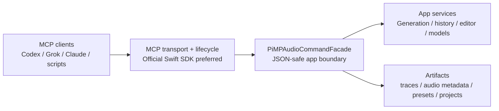

# MCP Standards Roadmap

This document records the direction for PiMP Audio Studio's local MCP surface after the
2026-05 standards review. The goal is to keep PiMP Audio Studio as close to the official
Model Context Protocol shape as practical while preserving the app-specific
command facade that already protects generation, history, adapter, and model
state.

## Decision

PiMP Audio Studio should move toward an SDK-backed or spec-conformant MCP server instead of
letting the current hand-rolled JSON-RPC/HTTP implementation grow into a larger
custom protocol.

The existing `PiMPAudioCommandFacade` remains the right internal boundary. It
should continue to expose JSON-safe app commands and resources. The protocol
transport and MCP data-layer responsibilities should move toward the official
Swift SDK if the SDK can support the app-hosted localhost use case cleanly.

## Why

PiMP Audio Studio is expected to grow beyond simple generation into richer editing and
workstation workflows. A larger audio surface will need first-class support for
long-running operations, progress, cancellation, reusable workflows, resources,
and structured confirmations. Those are MCP protocol concerns, not business
logic concerns, and they should not be reinvented piecemeal inside
`PiMPAudioMCPServer`.

## Current State

- `PiMPAudioMCPServer` is a local, app-hosted, localhost-only HTTP endpoint at
  `http://127.0.0.1:38765/mcp`.
- The server implements the small method set PiMP Audio Studio currently needs:
  `initialize`, `ping`, `tools/list`, `tools/call`, `resources/list`,
  `resources/read`, `resources/templates/list`, `prompts/list`, `prompts/get`,
  and `completion/complete`.
- Tool/resource registration, lifecycle handling, structured tool results,
  JSON-RPC dispatch, stateful Streamable HTTP sessions, and SSE response
  handling now run through the official Swift MCP SDK.
- PiMP Audio Studio still owns the lightweight localhost socket listener so the app can
  keep its existing settings UI, token gate, and process-local endpoint.
- The public tool catalog uses plain snake_case names such as `list_history`,
  `generate_song`, and `release_memory`.
- Legacy dotted and underscored Anvil aliases are removed from the public MCP
  surface before release.
- MCP-submitted generation now creates an operation record with stable
  `operationID`, status, progress payload, latest result/error, and a
  cancellation hook.
- `editor_status` exposes the shared editor coordinator readiness, loaded audio
  metadata, supported action descriptors, and the active editor operation.
- `load_editor_audio` is the first editor operation registered through the same
  pollable operation layer. It loads a history/audio id or readable local path
  into the editor coordinator, encodes editable latents, and reports as
  `editor.loadAudio`.
- `submit_editor_inpaint` submits confirmed editor inpaint/repaint mutations
  through the operation layer. Dry runs validate request shape without touching
  audio; actual runs require loaded editor audio plus `confirm: true` or MCP
  form elicitation approval, then report as `editor.inpaint`.
- `apply_editor_effect_chain` submits confirmed bounded DSP mutations through
  the same operation layer. Dry runs validate one effect or an ordered effect
  chain; actual runs apply the existing editor DSP processor, refresh editable
  latents, and report as `editor.applyEffectChain` after `confirm: true` or MCP
  form elicitation approval.
- `render_editor_audio` exports the current editor buffer or selected time range
  to a lossless local file through the same operation layer, reporting as
  `editor.renderAudio`.
- Workstation resources now expose the current local project/session, current
  track, loaded clip, current/last editor region, recent takes, saved/built-in
  presets, and workflow prompt metadata:
  `pimpaudio://project/current`, `pimpaudio://track/current`,
  `pimpaudio://clip/current`, `pimpaudio://region/current-selection`,
  `pimpaudio://takes`, `pimpaudio://take/{id}`, `pimpaudio://presets`,
  `pimpaudio://preset/{id}`, `pimpaudio://workflows`, and
  `pimpaudio://workflow/{id}`.
- Resource templates are now advertised through `resources/templates/list` for
  model, adapter, history, take, trace, audio, preset, workflow, and operation
  URI patterns.
- Client roots are tracked through the Swift SDK roots primitives when a client
  advertises the roots capability. PiMP Audio Studio exposes the current roots and local
  path policy as `pimpaudio://client-roots`; roots guide safe path choices but do
  not bypass macOS sandbox permissions.
- The SDK-backed server advertises workflow prompts through `prompts/list` and
  `prompts/get`: `improve_chorus`, `create_mix_variants`,
  `clean_up_region`, `prepare_stems_for_review`, and
  `production_ready_prompt`.
- The SDK-backed server advertises `completions` and handles
  `completion/complete` for workflow prompt arguments and resource-template
  ids, including take IDs, region times, presets, workflows, and operations.
- Operation state is exposed through `list_operations`, `get_operation`,
  `cancel_operation`, `generation_status.currentOperation`,
  `editor_status.currentOperation`, `pimpaudio://editor`, `pimpaudio://operations`,
  and `pimpaudio://operation/{id}`.
- The current SDK bridge uses `StatefulHTTPServerTransport`, so `initialize`
  returns `MCP-Session-Id`, `POST /mcp` may return SSE, `GET /mcp` opens the
  standalone SSE stream, and `DELETE /mcp` terminates the session. PiMP Audio Studio resets
  the embedded SDK transport after a successful `DELETE` so local clients can
  initialize again without restarting the app.
- Normal macOS app termination now explicitly stops the local MCP server so the
  localhost listener is closed during quit rather than relying only on object
  teardown.
- Request-scoped progress notifications are supported when clients include
  `_meta.progressToken` and keep `GET /mcp` open. Background app operations are
  still exposed through pollable operation records because MCP progress tokens
  remain valid after a response only for task-augmented requests.
- Guarded MCP mutations preserve `confirm: true` as the compatibility path and
  use SDK `elicitation/create` form prompts when the initialized client
  advertises form elicitation support. Decline/cancel responses return no-op
  structured results and do not reach the app mutation path.
- The current Swift SDK integration does not expose MCP task capability types
  yet, so `tasks/get`, `tasks/result`, `tasks/list`, and `tasks/cancel` remain a
  future experimental slice rather than a hand-rolled partial protocol.

## Target Shape



The transport layer should own MCP concerns:

- protocol version negotiation
- lifecycle and initialized notifications
- tool/resource/prompt schema handling
- Streamable HTTP behavior
- cancellation, progress, and future task support
- optional authentication and session behavior

The facade should own PiMP Audio Studio concerns:

- validation of generation and editing requests
- adapter/model/history lookup
- trace comparison and preferred-take metadata writes
- safe JSON DTOs for resources and tool outputs
- guarding expensive or destructive actions

## DAW-Style Future Surface

For a fuller editing workstation, prefer protocol primitives over broad generic
tools.

Resources should describe state:

- `pimpaudio://projects`
- `pimpaudio://project/{id}`
- `pimpaudio://project/{id}/tracks`
- `pimpaudio://track/{id}`
- `pimpaudio://clip/{id}`
- `pimpaudio://region/{id}`
- `pimpaudio://take/{id}`
- `pimpaudio://preset/{id}`
- `pimpaudio://trace/{id}`
- `pimpaudio://audio/{id}`

Tools should perform bounded actions:

- generate a new take
- edit or inpaint a selected region
- apply an effect chain
- render or bounce a selection
- compare takes
- mark a take as preferred
- release memory
- start, pause, or resume training only with stronger safeguards

Prompts should capture reusable workflows:

- improve this chorus
- create three mix variants
- clean up this dialogue clip
- prepare stems for review
- make a sparse prompt more production-ready

Long-running operations should use progress and cancellation support where the
client supports it. Expensive or destructive actions should continue accepting
explicit confirmation arguments and use MCP elicitation when the host client
advertises support.

The current polling-compatible operation layer is intentionally shaped around
MCP progress semantics: operation progress payloads use normalized `progress`,
`total`, and `message` fields, with `stageProgress` and `stageTotal` included
when the active stage has its own counters. Request-scoped
`notifications/progress` now cover tool-call start/completion/failure events
when a progress token is supplied. Background generation/editor progress should
remain on the operation record until a later task/progress design maps app
operations to MCP task-augmented requests for their full lifetime.
`load_editor_audio` proved the same operation shape for editor-owned work;
inpaint, DSP, and render now extend that pattern. `cancel_operation` gives
clients an app tool today, while SDK `notifications/cancelled` handling covers
in-flight MCP request cancellation.

## Swift 6 Migration Posture

The official Swift SDK currently targets Swift 6.0+ / Xcode 16+. PiMP Audio Studio should
not flip the entire app to Swift 6 language mode as the first step. Instead:

1. Keep the current Swift 5.10 language mode while repairing stale tests.
2. Enable stricter concurrency checking as warnings to identify migration work.
3. Isolate any SDK spike behind a small MCP adapter target if possible.
4. Move raw `MLXArray` and GPU-owned state behind actors or service boundaries;
   MCP-facing DTOs must remain JSON-safe and `Sendable`-friendly.
5. Promote modules or targets to Swift 6 only after the warning surface is
   understood.

Expected work includes `@MainActor` isolation, `Sendable` fixes, actor-boundary
cleanup, and some `@preconcurrency import` usage for dependencies that are not
fully annotated yet.

Phase 0 warning inventory was refreshed with:

```bash
swift build --package-path PiMPAudioCore \
  -Xswiftc -warn-concurrency \
  -Xswiftc -strict-concurrency=complete
```

Known warning groups:

- `MLXArray` is not `Sendable` but is stored in `Sendable` types:
  `SFXInpaintConditioning`, `LoRAContribution`, and `TrainingSample`.
- `ModelRegistry` calls actor-isolated persistence helpers from `init`:
  `loadUserSpecs`, `loadActiveModels`, and `migrateLegacyModelIDsIfNeeded`.
- Evaluation executables cross actor boundaries with `MLXArray` payloads:
  `DiTProbeEval` trace dictionaries and `QualityEval` weight/latent values.
- The compiler suggests `@preconcurrency import MLX` as a possible suppression
  for dependency annotation gaps, but the longer-term direction should keep
  MLX-owned tensor state behind actor/service boundaries.

## Implementation Plan

### Phase 0 - Baseline Cleanup

- [x] Update docs to show snake_case MCP tool names as the primary catalog.
- [x] Remove old Anvil prefix compatibility from the public MCP path before release.
- [x] Repair stale Swift package test fixtures for the current tokenizer,
      conditioning, VAE, DiT, SFX, editor, and LLM contracts.
- [x] Add a concurrency-warning inventory before changing language modes.
- [x] Add `scripts/test-pimpaudiocore-serial.sh` as the reliable Phase 0 package
      baseline.

Current test posture: use `scripts/test-pimpaudiocore-serial.sh` for MCP-related
baseline work. It enumerates PiMPAudioCore test suites and runs each suite filter in
its own `swift test` invocation. Raw `swift test --package-path PiMPAudioCore` still
exits with signal 5 in MLX convolution under the all-at-once Swift Testing
runner, so the next harness cleanup should serialize or isolate the MLX-heavy
suites before treating the raw package command as a required gate.

### Phase 1 - SDK Spike

- [x] Add the official Swift MCP SDK in a temporary branch or isolated target.
- [x] Re-expose only `list_history`, `resources/list`, and one read resource.
- [x] Compare SDK `tools/list`, `resources/list`, and `initialize` behavior at
      the transport-shape level against the current smoke-script methods.
- [x] Confirm whether app-hosted localhost Streamable HTTP is practical without
      forcing a helper-process architecture.

Spike result: `Spikes/MCPServerSDKSpike` resolved the official SDK at `0.12.1`
and validated the tiny read-only surface through both `InMemoryTransport` and
`StatelessHTTPServerTransport`. The stateless transport matched PiMP Audio Studio's earlier
POST/JSON-only endpoint closely enough to justify the SDK integration. The app
now uses the SDK's stateful transport, while PiMP Audio Studio still provides the localhost
socket listener and adapts raw requests/responses into the SDK's
framework-agnostic `HTTPRequest` and `HTTPResponse` types.

### Phase 2 - Transport Replacement or Spec Hardening

If the SDK fits:

- [x] Replace the custom MCP protocol dispatch shell with SDK primitives.
- [x] Keep `PiMPAudioCommandFacade` and existing tool semantics intact.
- [x] Preserve compatibility aliases unless they conflict with SDK validation.
- [x] Keep the existing localhost listener while adapting raw HTTP requests and
      responses into the SDK's framework-agnostic `HTTPRequest` and
      `HTTPResponse` types.
- [x] Switch the bridge from SDK stateless HTTP to
      `StatefulHTTPServerTransport`.
- [x] Stream SDK `.stream` responses through the app-hosted socket listener
      without `Content-Length`.
- [x] Update `scripts/smoke-pimpaudio-mcp.sh` for session ids, POST SSE parsing,
      `GET /mcp`, and request-scoped progress notifications.
- [x] Normalize operation progress payloads so `progress` / `total` describe
      whole-operation completion and stage-local counters use
      `stageProgress` / `stageTotal`.

If the SDK does not fit yet:

- Keep the custom transport temporarily.
- Align it closer to the official Streamable HTTP and lifecycle spec.
- Track each intentional divergence in this roadmap.

Implementation result: the app target now depends on `modelcontextprotocol/swift-sdk`
`0.12.1` and registers the current PiMP Audio Studio tool/resource catalog against SDK
`Server` handlers. The bridge now uses the SDK's stateful Streamable HTTP
transport. The remaining custom code is listener glue, token checking,
localhost-only origin gating, streaming socket writes, and conversion between
PiMP Audio Studio's JSON-safe facade payloads and SDK `Value` objects.

### Phase 3 - Rich Workstation Capabilities

- [x] Extend the current `editor.loadAudio` operation pattern to inpaint, DSP,
      and render actions with explicit confirmation where edits are destructive.
- [x] Add prompts for common editing/generation workflows.
- [x] Add project, track, clip, region, take, and preset resources.
- [x] Add resource templates and completions for workflow prompt/resource ids.
- [x] Track MCP client roots and expose the path-access policy through
      `pimpaudio://client-roots`.
- Map background generation/editor operation progress onto MCP task-augmented
  requests once the Swift SDK supports task capabilities, without breaking the
  pollable operation contract.
- Preserve `cancel_operation` for app-owned background jobs while relying on SDK
  cancellation notifications for in-flight MCP requests.
- Extend the current confirmation/elicitation pattern before adding broader
  destructive editing actions.
- Defer LAN/remote access until authentication and session posture are
  revisited.

## Acceptance Criteria

- A standards-based client can discover PiMP Audio Studio tools and resources without
  custom knowledge of PiMP Audio Studio's legacy names.
- Raw HTTP smoke tests and real MCP-client discovery both pass.
- `PiMPAudioCommandFacade` remains the only route from MCP into app services.
- Long-running work has operation IDs, pollable progress, and cancellation
  before new heavy tools are added.
- Remote or LAN exposure remains out of scope until auth/session design is
  explicitly revisited.

## References

- [MCP transport spec](https://modelcontextprotocol.io/specification/2025-11-25/basic/transports)
- [MCP lifecycle spec](https://modelcontextprotocol.io/specification/2025-11-25/basic/lifecycle)
- [MCP progress spec](https://modelcontextprotocol.io/specification/2025-11-25/basic/utilities/progress)
- [MCP tasks spec](https://modelcontextprotocol.io/specification/2025-11-25/basic/utilities/tasks)
- [MCP cancellation spec](https://modelcontextprotocol.io/specification/2025-11-25/basic/utilities/cancellation)
- [Official Swift SDK](https://github.com/modelcontextprotocol/swift-sdk)
- [Swift 6 adoption guide](https://developer.apple.com/documentation/Swift/AdoptingSwift6)
