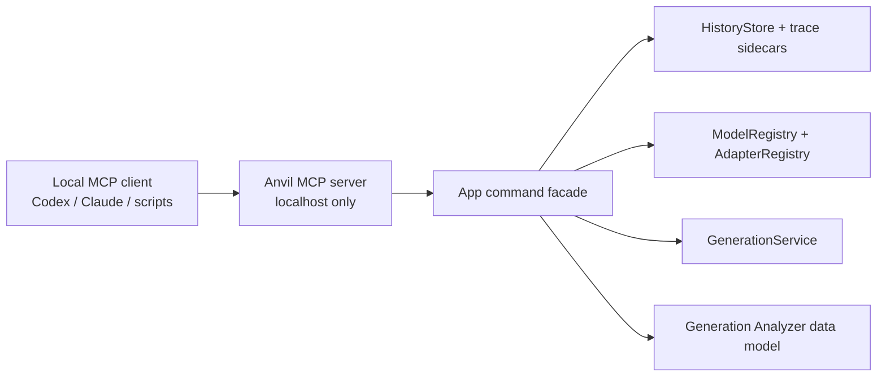

# MCP Integration — Design Spec

> **Codex planning note (2026-05-19):** This locks in the agreed MCP shape for
> Anvil. It is a planned integration, not an implemented feature. The design
> intentionally treats MCP as a local automation/control surface over existing
> app workflows, not as a dependency inside the audio generation pipeline.

## Goal

Expose Anvil to local agents and scripts through a small MCP server so tools
like Codex, Claude, and other local automation clients can inspect history,
read generation traces, compare takes, and eventually trigger controlled app
actions without driving the SwiftUI manually.

The first version should make the Generation Analyzer artifacts useful outside
the GUI. It should answer practical questions like:

- What models/adapters are active?
- What did this generation use?
- What changed between these two takes?
- Which take did the user prefer?
- Can Anvil generate another variant with the same seed/settings?

## Product Shape

The MCP server is a local command/control surface for Anvil.

- Off by default.
- Enabled from Settings.
- Localhost only: bind to `127.0.0.1` / `localhost`.
- Optional token/pairing secret for localhost use.
- Token required only if a future version allows LAN binding, tunnel exposure,
  remote/headless operation, or non-localhost hosts.
- Destructive or expensive tools require explicit confirmation arguments.
- Keep raw tensors and model internals out of v1.

## Security Model

| Concern | v1 Decision |
|---|---|
| Default exposure | Disabled |
| Network bind | Localhost only |
| Auth token | Optional for localhost |
| Remote/LAN access | Out of scope |
| Expensive actions | Require explicit arguments, e.g. `confirm: true` |
| Destructive actions | Require explicit arguments, e.g. `confirm: true` |
| Raw model/tensor access | Out of scope |

The server should be safe for same-machine agent workflows without making local
setup annoying. If Anvil ever supports remote access, the security model must be
revisited before that feature ships.

## v1 Capabilities

### Read-Only Tools

Ship these first because they are low-risk and immediately useful.

| Tool | Purpose |
|---|---|
| `anvil.list_models` | Return model registry status, active models, readiness, runtime support notes |
| `anvil.list_adapters` | Return local/community adapters, base model, rank, source, status |
| `anvil.list_history` | Return recent generation entries with model, seed, prompt summary, trace availability |
| `anvil.get_trace` | Return one trace sidecar by history id, trace filename, or audio filename |
| `anvil.compare_traces` | Return the same structured diff shown in the analyzer compare view |

### Controlled Action Tools

Add after read-only tools are stable.

| Tool | Purpose | Guard |
|---|---|---|
| `anvil.generate` | Submit a generation request using the same path as the UI | Validate prompt/duration/model readiness |
| `anvil.enhance_prompt` | Run the local/API prompt enhancer | No destructive effect |
| `anvil.write_lyrics` | Run lyric generation for prompt + duration | No destructive effect |
| `anvil.mark_preferred_take` | Save preferred flag and listening note into trace/history metadata | Existing trace required |
| `anvil.apply_adapter` | Select/stack adapters for next generation | Validate adapter/base model compatibility |
| `anvil.release_memory` | Run the existing release GPU memory path | Require `confirm: true` |

### Deferred Tools

These are useful, but should not be in the first pass.

- `anvil.train_lora_from_history`
- `anvil.resume_lora_training`
- `anvil.delete_history_entry`
- `anvil.delete_model`
- `anvil.set_active_model`
- Raw audio export over MCP
- Raw tensor/debug internals

## Resource Shape

After the tool layer is stable, expose structured resources so clients can
browse artifacts directly.

| Resource | Meaning |
|---|---|
| `anvil://models` | Active and available models |
| `anvil://adapters` | Adapter registry |
| `anvil://history` | Recent history index |
| `anvil://history/{id}` | One history entry |
| `anvil://trace/{id}` | One generation trace |
| `anvil://audio/{id}` | Metadata and file path for generated audio |

Resource responses should reference local file paths where appropriate instead
of streaming large audio blobs by default.

## Architecture

The MCP server should sit beside the app-command layer.

The MCP server should not reach into SwiftUI views. It should call a small
facade that wraps the same services the UI already uses.

## Implementation Notes

- Prefer JSON-serializable DTOs over exposing Swift model structs directly.
- Keep the transport behind a small abstraction so MCP server implementation
  details do not leak across the app.
- The first implementation can be app-hosted if practical, but a helper process
  is acceptable if it simplifies MCP transport or lifecycle.
- The Settings UI should clearly show server state: disabled, starting, running,
  failed, and local endpoint.
- If an optional token is enabled, show/copy/regenerate token controls in
  Settings. Do not require this for localhost-only workflows.
- Trace compare output should reuse the same comparison grouping as the
  analyzer: Model, Adapters, Sampling, Prompt & Lyrics, Audio.

## Non-Goals for v1

- Remote MCP access.
- Agent-visible raw tensors.
- Model weight inspection.
- Background/headless cloud server mode.
- Full training orchestration.
- Replacing the GUI.
- Turning Anvil into a general-purpose MCP host for arbitrary plugins.

