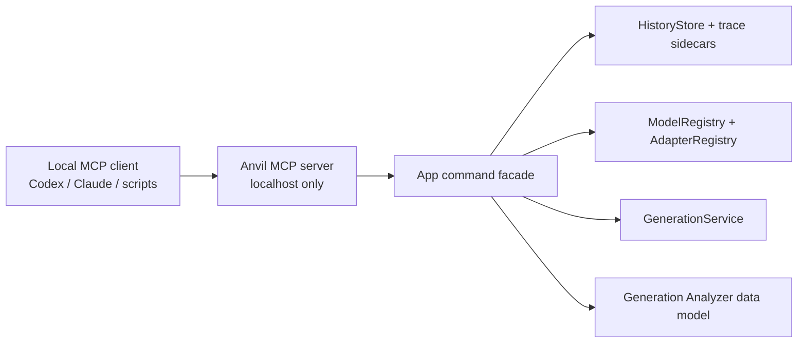

# MCP Integration — Design Spec

> **Codex planning note (2026-05-19):** This locks in the agreed MCP shape for
> Anvil. Phase 1 read-oriented localhost tools, Phase 2 read-only resources,
> the localhost smoke script, return-only prompt/lyric action tools, and the
> first controlled review-metadata write are now implemented.
>
> **Status (2026-09-14):** MCP v1 is in (SDK Streamable HTTP, guarded tools,
> pollable operations). Remaining work is MCP task mapping when the Swift SDK
> supports it, plus the still-deferred slices below.
>
> The design intentionally treats MCP as a local automation/control surface
> over existing app workflows, not as a dependency inside the audio generation
> pipeline.
>
> **Standards update (2026-05-20):** Anvil should move toward an SDK-backed or
> spec-conformant MCP layer as the local control surface grows into richer
> editing/workstation workflows. See `docs/mcp-standards-roadmap.md`.

## Goal

Expose Anvil to local agents and scripts through a small MCP server so tools
like Codex, Claude, and other local automation clients can inspect history,
read generation traces, compare takes, and eventually trigger controlled app
actions without driving the SwiftUI manually.

The first version should make the Generation Analyzer artifacts useful outside
the GUI. It should answer practical questions like:

- What models/adapters are active?
- What did this generation use?
- What changed between these two takes?
- Which take did the user prefer?
- Can Anvil generate another variant with the same seed/settings?

## Product Shape

The MCP server is a local command/control surface for Anvil.

- Off by default.
- Enabled from Settings.
- Localhost only: bind to `127.0.0.1` / `localhost`.
- Optional token/pairing secret for localhost use.
- Token required only if a future version allows LAN binding, tunnel exposure,
  remote/headless operation, or non-localhost hosts.
- Destructive or expensive tools require explicit confirmation arguments.
- Keep raw tensors and model internals out of v1.

## Security Model

- Default exposure: disabled.
- Network bind: localhost only.
- Auth token: optional for localhost.
- Remote/LAN access: out of scope.
- Expensive actions: require explicit confirmation, either `confirm: true` or
  MCP form elicitation approval when the client advertises support.
- Destructive actions: require explicit confirmation, either `confirm: true` or
  MCP form elicitation approval when the client advertises support.
- Raw model/tensor access: out of scope.

The server should be safe for same-machine agent workflows without making local
setup annoying. If Anvil ever supports remote access, the security model must be
revisited before that feature ships.

## Standards Alignment

The app-specific boundary is `AnvilCommandFacade`: it owns validation,
generation/editor/model access, trace comparison, and JSON-safe DTOs. The MCP
layer should own protocol concerns such as lifecycle, tool/resource/prompt
schemas, transport behavior, cancellation, progress, and future session/auth
features.

The preferred direction has moved to the official Swift MCP SDK. The app keeps
its localhost listener, Settings controls, optional token gate, and
`AnvilCommandFacade` boundary, while the SDK owns lifecycle, tool/resource
dispatch, structured tool output, JSON-RPC dispatch, stateful Streamable HTTP
sessions, and SSE response shape.

Public tool names should stay plain snake_case to match the sibling Anvil MCP
surface and the current live catalog. Legacy aliases with `anvil.` and
`anvil_` prefixes may remain callable for compatibility, but docs should treat
snake_case as primary.

## v1 Capabilities

### Read-Only Tools

Ship these first because they are low-risk and immediately useful.

- `list_models`: return model registry status, active models, readiness, and
  runtime support notes.
- `list_adapters`: return local/community adapters, base model, rank, source,
  and status.
- `list_history`: return recent generation entries with model, seed, prompt
  summary, and trace availability.
- `get_trace`: return one trace sidecar by history id, trace filename, or audio
  filename.
- `compare_traces`: return the same structured diff shown in the analyzer
  compare view.

### Controlled Action Tools

Add after read-only tools are stable.

- `generate_song`: optionally enhance prompt, write lyrics, apply adapters, then
  submit generation. Guard: validate prompt/duration/model readiness;
  implemented with `dryRun`.
- `generate`: submit a generation request using the same path as the UI.
  Guard: validate prompt/duration/model readiness; implemented with `dryRun`.
- `generation_status`: poll current generation state, current operation, and
  latest result. Guard: read-only status; implemented.
- `editor_status`: poll editor readiness, loaded audio metadata, supported
  editor action descriptors, and the active editor operation. Guard: read-only
  status; implemented.
- `load_editor_audio`: load a history/audio id or readable local audio path
  into the shared editor coordinator. Guard: validates the source, returns an
  operation id, and does not apply edits; implemented.
- `submit_editor_inpaint`: submit an inpaint/repaint request against the loaded
  editor audio. Guard: requires `confirm: true` or MCP form elicitation approval
  for mutation, supports `dryRun`, returns an operation id; implemented.
- `apply_editor_effect_chain`: submit one or more DSP effects against the
  loaded editor audio. Guard: requires `confirm: true` or MCP form elicitation
  approval for mutation, supports `dryRun`, refreshes editable latents after
  apply; implemented.
- `render_editor_audio`: render the loaded editor buffer or a selected time
  range to WAV/AIFF. Guard: refuses overwrite unless requested, supports
  `dryRun`, returns an operation id; implemented.
- `list_operations`: list recent MCP-observable operations. Guard: read-only
  operation state; implemented.
- `get_operation`: read one operation by id. Guard: read-only operation state;
  implemented.
- `cancel_operation`: cancel a running operation by id. Guard: scoped to active
  generation and background editor-load operations; implemented.
- `enhance_prompt`: run the local/API prompt enhancer. Guard: return-only;
  implemented.
- `write_lyrics`: run lyric generation for prompt and duration. Guard:
  return-only; implemented.
- `mark_preferred_take`: save preferred flag and listening note into
  trace/history metadata. Guard: existing trace required; implemented as review
  metadata only.
- `apply_adapter`: select or stack adapters for next generation. Guard:
  validates adapter/base model compatibility; implemented.
- `release_memory`: run the existing release GPU memory path. Guard: requires
  `confirm: true` or MCP form elicitation approval; implemented.
- `set_active_model`: activate a ready registry model for its category.
  Guard: requires `confirm: true` or MCP form elicitation; implemented.
- `delete_history_entries`: delete selected history IDs or all history.
  Guard: requires `confirm: true` or MCP form elicitation; implemented.
  Spec name was `delete_history_entry`.

### Deferred Tools

These remain useful and are still not MCP tools. Local training over MCP is
`start_training` / `stop_training` from a reviewed dataset package only.

- `train_lora_from_history` — not exposed; `start_training` does not take
  history entries
- `resume_lora_training` — not exposed; MCP does not pass `resumeAdapterID`
- `delete_model` — not exposed; UI uses `ModelRegistry.deleteModelFiles`
- Raw audio export over MCP
- Raw tensor/debug internals

## Resource Shape

After the tool layer is stable, expose structured resources so clients can
browse artifacts directly.

- `anvil://models`: active and available models.
- `anvil://adapters`: adapter registry.
- `anvil://history`: recent history index.
- `anvil://history/{id}`: one history entry.
- `anvil://project/current`: current local workstation/session snapshot.
- `anvil://track/current`: current editor track and loaded audio summary.
- `anvil://clip/current`: loaded editor audio as a clip-like resource.
- `anvil://region/current-selection`: current or most recently persisted editor
  selection metadata.
- `anvil://takes`: recent generated takes with links to history/audio/trace.
- `anvil://take/{id}`: workstation take view for a history row.
- `anvil://presets`: saved generation presets plus built-in guidance/editor/DSP
  preset catalogs.
- `anvil://preset/{id}`: one saved generation preset.
- `anvil://workflows`: reusable workflow prompt catalog.
- `anvil://workflow/{id}`: one workflow prompt definition with template text.
- `anvil://trace/{id}`: one generation trace.
- `anvil://audio/{id}`: metadata and file path for generated audio.
- `anvil://client-roots`: initialized client roots and local path-access
  policy.

Resource responses should reference local file paths where appropriate instead
of streaming large audio blobs by default.

Client roots should be discovered through the MCP roots primitive when the
initialized client advertises it. Roots are advisory path boundaries from the
client and should guide path suggestions only; Anvil must still respect the
app's actual macOS file permissions and should continue to prefer history/audio
ids for editor loading.

Resource templates should be exposed through `resources/templates/list` for
parameterized ids:

- `anvil://model/{id}`
- `anvil://adapter/{id}`
- `anvil://history/{id}`
- `anvil://take/{id}`
- `anvil://trace/{id}`
- `anvil://audio/{id}`
- `anvil://preset/{id}`
- `anvil://workflow/{id}`
- `anvil://operation/{id}`

## Prompt Shape

Reusable workflow prompts should be exposed through MCP `prompts/list` and
`prompts/get`, not as generic tools. Initial prompt names:

- `improve_chorus`
- `create_mix_variants`
- `clean_up_region`
- `prepare_stems_for_review`
- `production_ready_prompt`

Each prompt should point clients at the relevant Anvil resources and tools, and
should preserve the existing safety rules: dry-run validation before mutations
and `confirm: true` or MCP form elicitation approval for editor edits that
change audio.

The server should advertise MCP completions and handle `completion/complete`
for common workflow prompt arguments and resource-template ids. Completion
values should stay low-risk and reference existing local metadata such as
history/take ids, current region times, presets, workflows, and operation ids.
When client roots are available, path-oriented completions may include root
paths as suggestions.

## Architecture

The MCP server should sit beside the app-command layer.

The MCP server should not reach into SwiftUI views. It should call a small
facade that wraps the same services the UI already uses.

## Implementation Notes

- Prefer JSON-serializable DTOs over exposing Swift model structs directly.
- Keep the transport behind a small abstraction so MCP server implementation
  details do not leak across the app.
- The first implementation can be app-hosted if practical, but a helper process
  is acceptable if it simplifies MCP transport or lifecycle.
- The Settings UI should clearly show server state: disabled, starting, running,
  failed, and local endpoint.
- If an optional token is enabled, show/copy/regenerate token controls in
  Settings. Do not require this for localhost-only workflows.
- Trace compare output should reuse the same comparison grouping as the
  analyzer: Model, Adapters, Sampling, Prompt & Lyrics, Audio.
- `enhance_prompt` and `write_lyrics` should reuse the same
  service objects as the Generate view while returning text only; they should
  not write into SwiftUI fields or generation history.
- The first controlled write tool is `mark_preferred_take`; it must stay
  limited to `isPreferred` and `listeningNote` fields on existing trace/history
  records unless a later spec explicitly expands MCP write scope.
- `apply_adapter` should update app selection state only. It should not
  load tensors, mutate adapter files, or start generation; it should validate
  adapter existence/category and keep GUI state aligned when the Generate view
  is open.
- `generate_song` may orchestrate prompt enhancement, lyric writing, adapter
  selection, and generation submission, but `dryRun` must not mutate state.
- `generate` should submit through `GenerationService` and return immediately.
  Long renders should be observed through `generation_status`,
  history entries, and trace resources rather than by holding the tool call open.
- MCP-submitted long-running work should register an operation id before the
  tool returns. Operation payloads should include status, progress, result/error,
  and cancellation metadata. `progress` / `total` should describe normalized
  whole-operation completion; stage-local counters can be exposed as
  `stageProgress` / `stageTotal`.
- Editor-owned work follows the same operation contract. Implemented editor
  operations are `editor.loadAudio`, `editor.inpaint`,
  `editor.applyEffectChain`, and `editor.renderAudio`; DSP tools require
  explicit confirmation where they mutate audio destructively.
- `tools/call` requests may include `_meta.progressToken`. When a token is
  supplied and the client keeps `GET /mcp` open, Anvil emits request-scoped
  `notifications/progress` for start/completion/failure. These notifications
  are not a replacement for polling a submitted background operation id because
  MCP keeps a progress token valid after the original response only for
  task-augmented requests.
- Full background-operation protocol progress should wait for MCP task support
  in the Swift SDK, then map Anvil operation ids onto `tasks/*` without
  removing the current pollable operation tools.
- `cancel_operation` should only cancel the matching active operation. It must
  not become a broad "stop everything" button unless a future version adds an
  explicit guarded bulk-cancel action.
- `release_memory` should remain a guarded cleanup action. It may cancel
  active generation, unload resident models, and flush MLX GPU cache, so it
  requires `confirm: true` or MCP form elicitation approval and returns
  before/after memory counters instead of running silently.

## Non-Goals for v1

- Remote MCP access.
- Agent-visible raw tensors.
- Model weight inspection.
- Background/headless cloud server mode.
- Full training orchestration.
- Replacing the GUI.
- Turning Anvil into a general-purpose MCP host for arbitrary plugins.
